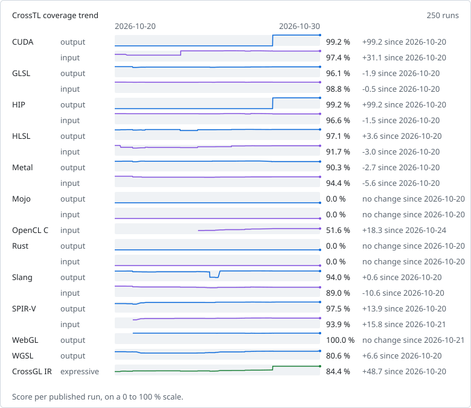

# CrossTL coverage

Measured on commit [`4597d48`](https://github.com/namanraii/crosstl/commit/4597d48649807590926f6496299fd834325291d9) at 2026-11-14T08:20:45Z (CrossTL 3.7.0) by the [Coverage workflow](https://github.com/namanraii/crosstl/actions/workflows/coverage.yml), which publishes this file on every push to `main` and nightly. Run `python -m tools.coverage run` to measure locally.

Every feature in a pinned upstream feature list gets a generated probe. For output, CrossTL translates a CrossGL probe to the language; for input, it imports a native probe and translates it back. The native SPIR-V probe is the module glslang compiles the GLSL probe to, and its round trip must keep the feature's instruction. The language's reference tool then validates the result:

- **supported**: the reference tool accepts the translation and, where it runs, the translation computes what the native probe computes;
- **refused**: CrossTL rejects the feature with a diagnostic;
- **wrong**: CrossTL produces output the reference tool rejects or that computes other results, writes a placeholder comment in place of the feature, or fails without a diagnostic;
- **untested**: no probe can be built for the feature yet, or the reference tool rejects the probe itself.

Score = supported / (supported + refused + wrong). Untested features are shown separately and do not count. The CrossGL IR row covers the union of every language's output features, merged into semantic features through the SPIR-V each native probe lowers to; a semantic feature is expressible when its CrossGL probe translates correctly to at least one language that has it, or to valid SPIR-V that lowers to the same semantic feature.

Where Core's conformance harness has a runtime for the language, a supported compute probe whose translation reads the native probe's input buffers also runs: the two get the same inputs, and a translation that binds other resources or writes other results is wrong. HLSL, Slang, WGSL and Rust probes run as the SPIR-V their reference compiler writes for them, and so do GLSL probes that llvmpipe's OpenGL rejects. Executed: GLSL output, 339 probes on opengl-llvmpipe, vulkan-lavapipe; GLSL input, 339 probes on opengl-llvmpipe, vulkan-lavapipe; HLSL output, 345 probes on vulkan-lavapipe; HLSL input, 346 probes on vulkan-lavapipe; Metal output, 407 probes on metal-apple; Metal input, 421 probes on metal-apple; Slang output, 396 probes on vulkan-lavapipe; Slang input, 372 probes on vulkan-lavapipe; SPIR-V output, 364 probes on vulkan-lavapipe; SPIR-V input, 357 probes on vulkan-lavapipe; WGSL output, 281 probes on vulkan-lavapipe.

| Language | Direction | Score | Supported | Refused | Wrong | Untested |
|---|---|---:|---:|---:|---:|---:|
| CUDA | output | 98.7 % | 661 | 0 | 9 | 0 |
| CUDA | input | 96.1 % | 644 | 17 | 9 | 0 |
| GLSL | output | 96.7 % | 505 | 8 | 9 | 0 |
| GLSL | input | 99.2 % | 518 | 1 | 3 | 0 |
| HIP | output | 98.2 % | 544 | 2 | 8 | 0 |
| HIP | input | 94.8 % | 525 | 20 | 9 | 0 |
| HLSL | output | 97.4 % | 797 | 14 | 7 | 11 |
| HLSL | input | 94.1 % | 770 | 36 | 12 | 11 |
| Metal | output | 92.1 % | 498 | 12 | 31 | 0 |
| Metal | input | 91.1 % | 493 | 28 | 20 | 0 |
| Mojo | output | 0.0 % | 0 | 7 | 260 | 0 |
| Mojo | input | 0.0 % | 0 | 266 | 1 | 0 |
| OpenCL C | output | not offered | | | | |
| OpenCL C | input | 52.7 % | 363 | 316 | 10 | 0 |
| Rust | output | 0.0 % | 0 | 75 | 555 | 3 |
| Rust | input | 0.0 % | 0 | 178 | 451 | 4 |
| Slang | output | 82.5 % | 570 | 81 | 40 | 13 |
| Slang | input | 73.7 % | 509 | 132 | 50 | 13 |
| SPIR-V | output | 96.4 % | 505 | 14 | 5 | 3 |
| SPIR-V | input | 95.1 % | 500 | 11 | 15 | 1 |
| WebGL | output | 99.7 % | 297 | 1 | 0 | 0 |
| WebGL | input | not offered | | | | |
| WGSL | output | 85.3 % | 343 | 2 | 57 | 1 |
| WGSL | input | not offered | | | | |
| CrossGL IR | expressiveness | 89.2 % | 1336 | 65 | 96 | 24 |

OpenCL C output is not offered: CrossTL has no OpenCL C generator.
WebGL input is not offered: CrossTL has no WebGL source frontend.
WGSL input is not offered: CrossTL has no WGSL source frontend.

## Trend

## By category

Each cell counts the supported features of a category over its supported, refused and wrong ones. Untested features are left out, and a blank cell means none of the category's features could be measured.

| Language | Direction | compute | control-flow | function | graphics | method | operator | resource | stage | type |
|---|---|---:|---:|---:|---:|---:|---:|---:|---:|---:|
| CUDA | output | 13/18 | 59/60 | 469/469 | | | 33/33 | 43/45 | 1/1 | 43/44 |
| CUDA | input | 18/18 | 57/60 | 450/469 | | | 33/33 | 43/45 | 1/1 | 42/44 |
| GLSL | output | 28/28 | 59/59 | 166/170 | 60/69 | | 50/50 | 65/67 | 12/14 | 65/65 |
| GLSL | input | 28/28 | 59/59 | 170/170 | 67/69 | | 50/50 | 65/67 | 14/14 | 65/65 |
| HIP | output | 13/18 | 59/60 | 351/353 | | | 33/33 | 44/45 | 1/1 | 43/44 |
| HIP | input | 18/18 | 57/60 | 331/353 | | | 33/33 | 43/45 | 1/1 | 42/44 |
| HLSL | output | 13/13 | 60/62 | 195/198 | 60/63 | 273/285 | 50/50 | 66/67 | 14/14 | 66/66 |
| HLSL | input | 13/13 | 62/62 | 194/198 | 61/63 | 245/285 | 49/50 | 67/67 | 14/14 | 65/66 |
| Metal | output | 25/25 | 61/62 | 216/224 | 39/45 | | 50/50 | 38/64 | 5/7 | 64/64 |
| Metal | input | 19/25 | 62/62 | 205/224 | 28/45 | | 50/50 | 63/64 | 3/7 | 63/64 |
| Mojo | output | 0/16 | 0/47 | 0/83 | | | 0/41 | 0/29 | 0/1 | 0/50 |
| Mojo | input | 0/16 | 0/47 | 0/83 | | | 0/41 | 0/29 | 0/1 | 0/50 |
| OpenCL C | input | 13/18 | 48/57 | 168/474 | | | 42/43 | 42/45 | 1/1 | 49/51 |
| Rust | output | 0/17 | 0/54 | 0/311 | 0/64 | | 0/46 | 0/62 | 0/14 | 0/62 |
| Rust | input | 0/17 | 0/54 | 0/310 | 0/64 | | 0/46 | 0/62 | 0/14 | 0/62 |
| Slang | output | 20/24 | 61/62 | 243/339 | 53/67 | | 50/50 | 64/67 | 14/14 | 65/68 |
| Slang | input | 19/24 | 55/62 | 202/339 | 45/67 | | 49/50 | 64/67 | 11/14 | 64/68 |
| SPIR-V | output | 28/28 | 61/62 | 158/161 | 61/73 | | 51/51 | 67/67 | 12/14 | 67/68 |
| SPIR-V | input | 28/28 | 62/62 | 154/163 | 67/73 | | 50/51 | 61/67 | 14/14 | 64/68 |
| WebGL | output | | 58/58 | 89/89 | 11/12 | | 50/50 | 32/32 | 2/2 | 55/55 |
| WGSL | output | 17/22 | 56/56 | 104/145 | 12/16 | | 47/48 | 51/57 | 3/3 | 53/55 |
| CrossGL IR | expressiveness | 28/28 | 61/62 | 877/1026 | 72/73 | 98/108 | 51/51 | 67/67 | 14/14 | 68/68 |

## Feature lists

| Language | Feature list | Pinned at |
|---|---|---|
| CUDA | [LLVM 23.1.3 device-side CUDA Math API wrappers](https://github.com/llvm/llvm-project/blob/0d261d1ca552c95a8f007e061c787ac7132fbcbc/clang/lib/Headers/__clang_cuda_math.h) | `0d261d1ca552` |
| CUDA | [LLVM 23.1.3 CUDA intrinsic and atomic wrappers](https://github.com/llvm/llvm-project/blob/0d261d1ca552c95a8f007e061c787ac7132fbcbc/clang/lib/Headers/__clang_cuda_device_functions.h) | `0d261d1ca552` |
| GLSL | [GLSL 4.60 specification, chapter 8 (built-in functions)](https://github.com/KhronosGroup/GLSL/blob/0099bf83b0288469917fc2e2972cb0a2b74d6711/chapters/builtinfunctions.adoc) | `0099bf83b028` |
| HIP | [LLVM 17.0.6 device-side HIP math functions and intrinsics](https://github.com/llvm/llvm-project/blob/6009708b4367171ccdbf4b5905cb6a803753fe18/clang/lib/Headers/__clang_hip_math.h) | `6009708b4367` |
| HIP | [ROCm 5.7.1 HIP atomic functions](https://github.com/ROCm/clr/blob/1949b1621a802ffb1492616adbae6154bfbe64ef/hipamd/include/hip/amd_detail/amd_hip_atomic.h) | `1949b1621a80` |
| HIP | [ROCm 5.7.1 HIP device functions (integer intrinsics, conversions, barriers)](https://github.com/ROCm/clr/blob/1949b1621a802ffb1492616adbae6154bfbe64ef/hipamd/include/hip/amd_detail/amd_device_functions.h) | `1949b1621a80` |
| HLSL | [DXC v1.9.2602.24 intrinsic table](https://github.com/microsoft/DirectXShaderCompiler/blob/d355aa8364d34df3f0822ba0de8d1dfc75ae6f48/utils/hct/gen_intrin_main.txt) | `d355aa8364d3` |
| Metal | [Metal Shading Language 4.1 standard library, from Apple metal version 32023.918 (metalfe-32023.918.1)](https://github.com/namanraii/crosstl/blob/4597d48649807590926f6496299fd834325291d9/tools/coverage/features/metal.txt) | this repository |
| Mojo | [Mojo 1.2.0 std.bit functions](https://github.com/modular/modular/blob/527d069ee11a41ac5320af1f9402db0a66b2b868/Mojo/stdlib/std/bit/bit.mojo) | `527d069ee11a` |
| Mojo | [Mojo 1.2.0 std.bit public API](https://github.com/modular/modular/blob/527d069ee11a41ac5320af1f9402db0a66b2b868/Mojo/stdlib/std/bit/__init__.mojo) | `527d069ee11a` |
| Mojo | [Mojo 1.2.0 std.math functions](https://github.com/modular/modular/blob/527d069ee11a41ac5320af1f9402db0a66b2b868/Mojo/stdlib/std/math/math.mojo) | `527d069ee11a` |
| Mojo | [Mojo 1.2.0 std.math public API](https://github.com/modular/modular/blob/527d069ee11a41ac5320af1f9402db0a66b2b868/Mojo/stdlib/std/math/__init__.mojo) | `527d069ee11a` |
| Mojo | [Mojo 1.2.0 floating-point predicates std.math re-exports](https://github.com/modular/modular/blob/527d069ee11a41ac5320af1f9402db0a66b2b868/Mojo/stdlib/std/utils/numerics.mojo) | `527d069ee11a` |
| OpenCL C | [LLVM 18.1.3 OpenCL C built-in function declarations](https://github.com/llvm/llvm-project/blob/c13b7485b87909fcf739f62cfa382b55407433c0/clang/lib/Headers/opencl-c.h) | `c13b7485b879` |
| Rust | [rust-gpu 0.11.0 spirv_std::arch](https://github.com/Rust-GPU/rust-gpu/blob/62401280ab4b512c734ad1aceee7553385e17418/crates/spirv-std/src/arch.rs) | `62401280ab4b` |
| Rust | [rust-gpu 0.11.0 spirv_std::arch, module atomics](https://github.com/Rust-GPU/rust-gpu/blob/62401280ab4b512c734ad1aceee7553385e17418/crates/spirv-std/src/arch/atomics.rs) | `62401280ab4b` |
| Rust | [rust-gpu 0.11.0 spirv_std::arch, module barrier](https://github.com/Rust-GPU/rust-gpu/blob/62401280ab4b512c734ad1aceee7553385e17418/crates/spirv-std/src/arch/barrier.rs) | `62401280ab4b` |
| Rust | [rust-gpu 0.11.0 spirv_std::arch, module demote_to_helper_invocation_ext](https://github.com/Rust-GPU/rust-gpu/blob/62401280ab4b512c734ad1aceee7553385e17418/crates/spirv-std/src/arch/demote_to_helper_invocation_ext.rs) | `62401280ab4b` |
| Rust | [rust-gpu 0.11.0 spirv_std::arch, module derivative](https://github.com/Rust-GPU/rust-gpu/blob/62401280ab4b512c734ad1aceee7553385e17418/crates/spirv-std/src/arch/derivative.rs) | `62401280ab4b` |
| Rust | [num-traits 0.2.19 Float trait](https://github.com/rust-num/num-traits/blob/7ec3d41d39b28190ec1d42db38021107b3951f3a/src/float.rs) | `7ec3d41d39b2` |
| Rust | [rust-gpu 0.11.0 spirv_std::arch, module mesh_shading](https://github.com/Rust-GPU/rust-gpu/blob/62401280ab4b512c734ad1aceee7553385e17418/crates/spirv-std/src/arch/mesh_shading.rs) | `62401280ab4b` |
| Rust | [rust-gpu 0.11.0 spirv_std::arch, module primitive](https://github.com/Rust-GPU/rust-gpu/blob/62401280ab4b512c734ad1aceee7553385e17418/crates/spirv-std/src/arch/primitive.rs) | `62401280ab4b` |
| Rust | [rust-gpu 0.11.0 spirv_std::arch, module ray_tracing](https://github.com/Rust-GPU/rust-gpu/blob/62401280ab4b512c734ad1aceee7553385e17418/crates/spirv-std/src/arch/ray_tracing.rs) | `62401280ab4b` |
| Rust | [rust-gpu 0.11.0 spirv_std::arch, module subgroup](https://github.com/Rust-GPU/rust-gpu/blob/62401280ab4b512c734ad1aceee7553385e17418/crates/spirv-std/src/arch/subgroup.rs) | `62401280ab4b` |
| Rust | [glam 0.34.1 Vec3](https://github.com/bitshifter/glam-rs/blob/f5c5a6b635c5be1b7e904808175470ed0f29f4ff/src/f32/vec3.rs) | `f5c5a6b635c5` |
| Slang | [Slang v2026.20 core module: HLSL-compatible built-in functions](https://github.com/shader-slang/slang/blob/d9ede2dd5836afc0e9586da18d9236b171d0faa8/source/slang/hlsl.meta.slang) | `d9ede2dd5836` |
| Slang | [Slang v2026.20 core module: core built-in functions](https://github.com/shader-slang/slang/blob/d9ede2dd5836afc0e9586da18d9236b171d0faa8/source/slang/core.meta.slang) | `d9ede2dd5836` |
| SPIR-V | [SPIR-V GLSL.std.450 extended instruction grammar](https://github.com/KhronosGroup/SPIRV-Headers/blob/496543121ce6419f23d6fa5d7194ba66c36212d2/include/spirv/unified1/extinst.glsl.std.450.grammar.json) | `496543121ce6` |
| SPIR-V | [SPIR-V core grammar (execution models, capabilities, storage classes, instructions)](https://github.com/KhronosGroup/SPIRV-Headers/blob/496543121ce6419f23d6fa5d7194ba66c36212d2/include/spirv/unified1/spirv.core.grammar.json) | `496543121ce6` |
| WebGL | [ANGLE's GLSL ES built-in function table](https://github.com/google/angle/blob/1ff891807e391d842c33d552ea26ab26b5341ef4/src/compiler/translator/builtin_function_declarations.txt) | `1ff891807e39` |
| WGSL | [Tint's WGSL built-in function definitions](https://github.com/google/dawn/blob/ff7c6960f62d4249f967a78448918eec21705a86/src/tint/lang/wgsl/wgsl.def) | `ff7c6960f62d` |

Reference tools: clang Ubuntu clang version 18.1.3 (1ubuntu1), dxc libdxcompiler.so: 1.9(5191-d355aa83)(1.9.0.5191), glslangValidator Glslang Version: 11:16.6.0, hipcc HIP version: 5.7.31921-0, metal Apple metal version 32023.921 (metalfe-32023.921.6), mojo Mojo 1.2.0 (2016d0cd), naga 30.0.1, nvcc nvcc: NVIDIA (R) Cuda compiler driver, rust-gpu rust-gpu 0.11.0 (rustc 1.99.0-nightly (d453bdd8f 2026-08-14)), slangc 2026.20, spirv-as SPIRV-Tools v2026.4 ef96ed763b43b59b33b31b362f09a02b729fa1c9, spirv-dis SPIRV-Tools v2026.4 ef96ed763b43b59b33b31b362f09a02b729fa1c9, spirv-val SPIRV-Tools v2026.4 ef96ed763b43b59b33b31b362f09a02b729fa1c9.

## Gaps

Each row's wrong and refused features are grouped by diagnostic. A diagnostic drops its line numbers and writes the probe's own variables as `<probe>`, and one that several features share writes each feature's name as `<feature>`. Untested features are grouped by the reason no probe could measure them.

### CUDA output

9 gaps: 0 refused, 9 wrong

Wrong, by cause ([open bug issues](https://github.com/namanraii/crosstl/issues?q=is:issue%20is:open%20label:coverage%20label:bug%20label:backend:cuda%20label:direction:output)):

- `identifier "<probe>" is undefined`: `shared-memory-in-helper`
- `identifier "V" is undefined in device code`: `constant-expression`
- `identifier "blend" is undefined`: `default-argument`
- `identifier "gl_NumSubgroups" is undefined`: `num-subgroups`
- `identifier "gl_SubgroupID" is undefined`: `subgroup-id`
- `identifier "gl_SubgroupInvocationID" is undefined`: `subgroup-invocation-id`
- `identifier "gl_SubgroupSize" is undefined`: `subgroup-size`
- `identifier "samplerBuffer" is undefined`: `texel-buffer`
- `no operator "*" matches these operands`: `uniform-vector`

### CUDA input

26 gaps: 17 refused, 9 wrong

Wrong, by cause ([open bug issues](https://github.com/namanraii/crosstl/issues?q=is:issue%20is:open%20label:coverage%20label:bug%20label:backend:cuda%20label:direction:input)):

- `CrossTL wrote a placeholder for what it could not translate` (6): `__byte_perm`, `__syncthreads_and`, `__syncthreads_count`, `__syncthreads_or`, `clock`, `clock64`
- `class "Span" has no member "width"`: `struct-method`
- `identifier "blend" is undefined`: `default-argument`
- `identifier "twice" is undefined`: `forward-declaration`

Refused, by diagnostic:

- `project.translate.cuda-lowering-unsupported: CudaLoweringRefused: CUDA cannot lower N construct: <feature>: the output part is not a single assignable value (target cuda) [project.translate.cuda-lowering-unsupported]` (10): `frexp`, `frexpf`, `modf`, `modff`, `remquo`, `remquof`, `sincos`, `sincosf`, `sincospi`, `sincospif`
- `project.translate.undeclared-function: UndeclaredFunctionError: function 'countLeadingZeros' is not declared: it is neither a CrossGL built-in function nor a function, structure method, type or callable value of the program (target cuda) [project.translate.undeclared-function]` (2): `__clz`, `__clzll`
- `project.translate.reference-parameter-unsupported: ReferenceParameterError: argument N of 'grow' binds a reference parameter to storage that other threads or other arguments can reach; CrossGL passes it in and out by copy (target cgl) [project.translate.reference-parameter-unsupported]`: `buffer-element-argument`
- `project.translate.undeclared-function: UndeclaredFunctionError: function 'fdivide' is not declared: it is neither a CrossGL built-in function nor a function, structure method, type or callable value of the program (target cuda) [project.translate.undeclared-function]`: `fdivide`
- `project.translate.undeclared-function: UndeclaredFunctionError: function 'surf2Dread' is not declared: it is neither a CrossGL built-in function nor a function, structure method, type or callable value of the program (target cuda) [project.translate.undeclared-function]`: `read-write-image`
- `project.translate.undeclared-type: UndeclaredTypeError: type 'N' is not declared: it is neither a CrossGL built-in type nor a structure, enumeration, type alias or generic parameter of the program (target cuda) [project.translate.undeclared-type]`: `constant-array-size`
- `project.translate.undeclared-type: UndeclaredTypeError: type 'T' is not declared: it is neither a CrossGL built-in type nor a structure, enumeration, type alias or generic parameter of the program (target cuda) [project.translate.undeclared-type]`: `generic-function`

### GLSL output

17 gaps: 8 refused, 9 wrong

Wrong, by cause ([open bug issues](https://github.com/namanraii/crosstl/issues?q=is:issue%20is:open%20label:coverage%20label:bug%20label:backend:glsl%20label:direction:output)):

- `on opengl-llvmpipe, the translation is rejected by the runtime` (3): `allInvocations`, `allInvocationsEqual`, `anyInvocation`
- `the translation loses ExecutionMode.PixelInterlockOrderedEXT, Capability.FragmentShaderPixelInterlockEXT, OpBeginInvocationInterlockEXT` (2): `rasterizer-ordered-buffer`, `rasterizer-ordered-image`
- `'crossgl_gl_FragDepth' : undeclared identifier`: `conservative-depth`
- `'location' : SPIR-V requires location for user input/output`: `subpassLoad`
- `the translation loses Capability.RuntimeDescriptorArray`: `unsized-array-of-textures`
- `the translation loses OpTypeSampler`: `shared-sampler`

Refused, by diagnostic:

- `project.translate.opengl-tessellation-patch-unsupported: TessellationPatchUnsupportedError: member 'PatchConstants.edges' carries SV_TessFactor, which the tessellation lowering does not carry yet; opengl tessellation shaders exchange control points through per-vertex arrays, patch variables and gl_TessLevelOuter/gl_TessLevelInner (target opengl) [project.translate.opengl-tessellation-patch` (7): `tessellation-control`, `tessellation-domain-isolines`, `tessellation-domain-quads`, `tessellation-evaluation`, `tessellation-level-input`, `tessellation-patch-input`, `tessellation-patch-output`
- `project.translate.opengl-lowering-unsupported: OpenGLLoweringRefused: OpenGL cannot lower N construct: 'gl_ViewIndex': the multiview view index exists only in Vulkan GLSL (GL_EXT_multiview); GL_OVR_multiview also needs the view count (layout(num_views)), which the source does not state (target opengl) [project.translate.opengl-lowering-unsupported]`: `view-index`

### GLSL input

4 gaps: 1 refused, 3 wrong

Wrong, by cause ([open bug issues](https://github.com/namanraii/crosstl/issues?q=is:issue%20is:open%20label:coverage%20label:bug%20label:backend:glsl%20label:direction:input)):

- `'crossgl_gl_FragDepth' : undeclared identifier`: `conservative-depth`
- `the translation loses Capability.RuntimeDescriptorArray`: `unsized-array-of-textures`
- `the translation loses OpTypeSampler`: `shared-sampler`

Refused, by diagnostic:

- `project.translate.opengl-lowering-unsupported: OpenGLLoweringRefused: OpenGL cannot lower N construct: 'gl_ViewIndex': the multiview view index exists only in Vulkan GLSL (GL_EXT_multiview); GL_OVR_multiview also needs the view count (layout(num_views)), which the source does not state (target opengl) [project.translate.opengl-lowering-unsupported]`: `view-index`

### HIP output

10 gaps: 2 refused, 8 wrong

Wrong, by cause ([open bug issues](https://github.com/namanraii/crosstl/issues?q=is:issue%20is:open%20label:coverage%20label:bug%20label:backend:hip%20label:direction:output)):

- `reference to __host__ variable 'V' in __global__ function`: `constant-expression`
- `unknown type name 'samplerBuffer'`: `texel-buffer`
- `use of undeclared identifier '<probe>'; did you mean 'time'?`: `shared-memory-in-helper`
- `use of undeclared identifier 'blend'`: `default-argument`
- `use of undeclared identifier 'gl_NumSubgroups'`: `num-subgroups`
- `use of undeclared identifier 'gl_SubgroupID'`: `subgroup-id`
- `use of undeclared identifier 'gl_SubgroupInvocationID'`: `subgroup-invocation-id`
- `use of undeclared identifier 'gl_SubgroupSize'`: `subgroup-size`

Refused, by diagnostic:

- `project.translate.undeclared-function: UndeclaredFunctionError: function '<feature>' is not declared: it is neither a CrossGL built-in function nor a function, structure method, type or callable value of the program (target hip) [project.translate.undeclared-function]` (2): `powi`, `powif`

### HIP input

29 gaps: 20 refused, 9 wrong

Wrong, by cause ([open bug issues](https://github.com/namanraii/crosstl/issues?q=is:issue%20is:open%20label:coverage%20label:bug%20label:backend:hip%20label:direction:input)):

- `CrossTL wrote a placeholder for what it could not translate` (7): `__ballot`, `__syncthreads_and`, `__syncthreads_count`, `__syncthreads_or`, `clock`, `clock64`, `wall_clock64`
- `redefinition of 'twice'`: `forward-declaration`
- `use of undeclared identifier 'blend'`: `default-argument`

Refused, by diagnostic:

- `project.translate.hip-lowering-unsupported: HipLoweringRefused: HIP cannot lower N construct: <feature>: the output part is not a single assignable value (target hip) [project.translate.hip-lowering-unsupported]` (11): `__sincosf`, `frexp`, `frexpf`, `modf`, `modff`, `remquo`, `remquof`, `sincos`, `sincosf`, `sincospi`, `sincospif`
- `project.translate.undeclared-function: UndeclaredFunctionError: function '<feature>' is not declared: it is neither a CrossGL built-in function nor a function, structure method, type or callable value of the program (target hip) [project.translate.undeclared-function]` (2): `powi`, `powif`
- `project.translate.undeclared-function: UndeclaredFunctionError: function 'countLeadingZeros' is not declared: it is neither a CrossGL built-in function nor a function, structure method, type or callable value of the program (target hip) [project.translate.undeclared-function]` (2): `__clz`, `__clzll`
- `project.translate.hip-record-semantics-unsupported: HipRecordSemanticError: HIP record method call 'width' is unsupported for record 'Span' in call expression`: `struct-method`
- `project.translate.hip-surface-byte-offset-unproven: HipSurfaceByteOffsetError: surf2Dwrite cannot scale its x byte offset N: the element type is unknown, so the offset cannot be shown to be a multiple of the element size [project.translate.hip-surface-byte-offset-unproven]`: `read-write-image`
- `project.translate.reference-parameter-unsupported: ReferenceParameterError: argument N of 'grow' binds a reference parameter to storage that other threads or other arguments can reach; CrossGL passes it in and out by copy (target cgl) [project.translate.reference-parameter-unsupported]`: `buffer-element-argument`
- `project.translate.undeclared-type: UndeclaredTypeError: type 'N' is not declared: it is neither a CrossGL built-in type nor a structure, enumeration, type alias or generic parameter of the program (target hip) [project.translate.undeclared-type]`: `constant-array-size`
- `project.translate.undeclared-type: UndeclaredTypeError: type 'T' is not declared: it is neither a CrossGL built-in type nor a structure, enumeration, type alias or generic parameter of the program (target hip) [project.translate.undeclared-type]`: `generic-function`

### HLSL output

21 gaps: 14 refused, 7 wrong

Wrong, by cause ([open bug issues](https://github.com/namanraii/crosstl/issues?q=is:issue%20is:open%20label:coverage%20label:bug%20label:backend:hlsl%20label:direction:output)):

- `on vulkan-lavapipe as SPIR-V from dxc, the translation computes different results from the native probe` (3): `buffer-row-major-non-square`, `fmod`, `intrinsic-name`
- `type 'Payload' used as payload requires that it is annotated with the [raypayload] attribute` (2): `DxHitObject.Invoke`, `DxHitObject.TraceRay`
- `Semantic depth_greater is invalid for shader model: ps`: `conservative-depth`
- `no matching function for call to 'blend'`: `default-argument`

Refused, by diagnostic:

- `CrossGL has no work-graph node stage` (11): `EmptyNodeInput.Count`, `EmptyNodeOutput.GroupIncrementOutputCount`, `EmptyNodeOutput.IsValid`, `EmptyNodeOutput.ThreadIncrementOutputCount`, `GetRemainingRecursionLevels`, `GroupNodeInputRecords.Count`, `GroupOrThreadNodeOutputRecords.OutputComplete`, `NodeOutput.GetGroupNodeOutputRecords`, `NodeOutput.GetThreadNodeOutputRecords`, `NodeOutput.IsValid`, `RWDispatchNodeInputRecord.FinishedCrossGroupSharing`
- `project.translate.directx-contextual-conversion-unrepresentable: DirectXContextualConversionError: DirectX canonical select requires a resolved boolean scalar or vector condition`: `select`
- `project.translate.directx-lowering-unsupported: DirectXLoweringRefused: DirectX cannot lower N construct: HLSL has no system value for the built-in @gl_HelperInvocation; it would become a user semantic no stage writes (target directx) [project.translate.directx-lowering-unsupported]`: `helper-invocation`
- `project.translate.directx-shader-record-buffer-unsupported: ShaderRecordBufferUnsupportedError: shader record buffer 'record' (GL_EXT_ray_tracing shaderRecordEXT) cannot be read on directx: Direct3D N passes shader record data as local root arguments, which need a local root signature, and CrossTL does not emit root signatures (target directx) [project.translate.directx-shader-record-buffer-u`: `ray-shader-record`

11 untested: function 5, method 6

- `needs shader model 6.10` (10): `ClusterID`, `DxHitObject.ClusterID`, `DxHitObject.TriangleObjectPosition`, `GetGroupWaveCount`, `GetGroupWaveIndex`, `RayQuery.CandidateClusterID`, `RayQuery.CandidateTriangleObjectPosition`, `RayQuery.CommittedClusterID`, `RayQuery.CommittedTriangleObjectPosition`, `TriangleObjectPosition`
- `DXC compiles printf only to SPIR-V; DXIL has no print operation`: `printf`

### HLSL input

48 gaps: 36 refused, 12 wrong

Wrong, by cause ([open bug issues](https://github.com/namanraii/crosstl/issues?q=is:issue%20is:open%20label:coverage%20label:bug%20label:backend:hlsl%20label:direction:input)):

- `ValueError: DirectX texture query operation 'textureQueryLod' requires a 2D floating coordinate for Texture1DArray: a1 has type float` (2): `Texture1DArray.CalculateLevelOfDetail`, `Texture1DArray.CalculateLevelOfDetailUnclamped`
- `ValueError: DirectX texture query operation 'textureQueryLod' requires a 3D floating coordinate for Texture2DArray: a1 has type float2` (2): `Texture2DArray.CalculateLevelOfDetail`, `Texture2DArray.CalculateLevelOfDetailUnclamped`
- `ValueError: DirectX texture query operation 'textureQueryLod' requires a 4D floating coordinate for TextureCubeArray: a1 has type float3` (2): `TextureCUBEArray.CalculateLevelOfDetail`, `TextureCUBEArray.CalculateLevelOfDetailUnclamped`
- `cannot <feature> from resource containing uint4` (2): `Texture2D.GatherRaw`, `Texture2DArray.GatherRaw`
- `on vulkan-lavapipe as SPIR-V from dxc, the translation computes different results from the native probe` (2): `fmod`, `nested-unary`
- `brackets are not allowed here; to declare an array, place the brackets after the name`: `array-return`
- `the translation loses ExecutionMode.DepthGreater`: `conservative-depth`

Refused, by diagnostic:

- `project.translate.directx-lowering-unsupported: DirectXLoweringRefused: DirectX cannot lower N constructs: semantic '@NodeLaunch' takes no argument in HLSL; its argument would be dropped; generation then failed: DirectX compute function '<probe>' cannot use return semantic 'NodeLaunch' with void return type (target directx) [project.translate.directx-lowering-unsupported]` (7): `GetRemainingRecursionLevels`, `GroupNodeInputRecords.Count`, `GroupOrThreadNodeOutputRecords.OutputComplete`, `NodeOutput.GetGroupNodeOutputRecords`, `NodeOutput.GetThreadNodeOutputRecords`, `NodeOutput.IsValid`, `RWDispatchNodeInputRecord.FinishedCrossGroupSharing`
- `project.translate.directx-import-unsupported: DirectXImportRefused: CrossGL cannot represent N HLSL construct: DirectX texture overload extras for <feature>: CrossGL has no operand for LOD bias (target cgl) [project.translate.directx-import-unsupported]` (6): `Texture1D.SampleCmpBias`, `Texture1DArray.SampleCmpBias`, `Texture2D.SampleCmpBias`, `Texture2DArray.SampleCmpBias`, `TextureCUBE.SampleCmpBias`, `TextureCUBEArray.SampleCmpBias`
- `project.translate.directx-import-unsupported: DirectXImportRefused: CrossGL cannot represent N HLSL construct: DirectX texture gather-compare component for Texture2D: <feature> requires a compare-gather component selector; CrossGL only represents the default/red compare gather (target cgl) [project.translate.directx-import-unsupported]` (3): `Texture2D.GatherCmpAlpha`, `Texture2D.GatherCmpBlue`, `Texture2D.GatherCmpGreen`
- `project.translate.directx-import-unsupported: DirectXImportRefused: CrossGL cannot represent N HLSL construct: DirectX texture gather-compare component for Texture2DArray: <feature> requires a compare-gather component selector; CrossGL only represents the default/red compare gather (target cgl) [project.translate.directx-import-unsupported]` (3): `Texture2DArray.GatherCmpAlpha`, `Texture2DArray.GatherCmpBlue`, `Texture2DArray.GatherCmpGreen`
- `project.translate.directx-import-unsupported: DirectXImportRefused: CrossGL cannot represent N HLSL construct: DirectX texture gather-compare component for TextureCube: <feature> requires a compare-gather component selector; CrossGL only represents the default/red compare gather (target cgl) [project.translate.directx-import-unsupported]` (3): `TextureCUBE.GatherCmpAlpha`, `TextureCUBE.GatherCmpBlue`, `TextureCUBE.GatherCmpGreen`
- `project.translate.directx-import-unsupported: DirectXImportRefused: CrossGL cannot represent N HLSL construct: DirectX texture gather-compare component for TextureCubeArray: <feature> requires a compare-gather component selector; CrossGL only represents the default/red compare gather (target cgl) [project.translate.directx-import-unsupported]` (3): `TextureCUBEArray.GatherCmpAlpha`, `TextureCUBEArray.GatherCmpBlue`, `TextureCUBEArray.GatherCmpGreen`
- `project.translate.undeclared-type: UndeclaredTypeError: type 'EmptyNodeOutput' is not declared: it is neither a CrossGL built-in type nor a structure, enumeration, type alias or generic parameter of the program (target directx) [project.translate.undeclared-type]` (3): `EmptyNodeOutput.GroupIncrementOutputCount`, `EmptyNodeOutput.IsValid`, `EmptyNodeOutput.ThreadIncrementOutputCount`
- `project.translate.undeclared-function: UndeclaredFunctionError: function 'textureSamplePosition' is not declared: it is neither a CrossGL built-in function nor a function, structure method, type or callable value of the program (target directx) [project.translate.undeclared-function]` (2): `Texture2DArrayMS.GetSamplePosition`, `Texture2DMS.GetSamplePosition`
- `project.translate.builtin-value-unsupported: BuiltinValueUnsupportedError: gl_HelperInvocation in '<probe>' of the compute stage is not a compute built-in in GLSL; GLSL declares gl_HelperInvocation as an input of fragment (GLSL N.N section N.N) (target directx) [project.translate.builtin-value-unsupported]`: `IsHelperLane`
- `project.translate.directx-import-unsupported: DirectXImportRefused: CrossGL cannot represent N HLSL construct: DirectX texture sample-position query for RWTexture2DMS: GetSamplePosition is only available on sampled multisample textures (target cgl) [project.translate.directx-import-unsupported]`: `RWTexture2DMS.GetSamplePosition`
- `project.translate.directx-import-unsupported: DirectXImportRefused: CrossGL cannot represent N HLSL construct: DirectX texture sample-position query for RWTexture2DMSArray: GetSamplePosition is only available on sampled multisample textures (target cgl) [project.translate.directx-import-unsupported]`: `RWTexture2DMSArray.GetSamplePosition`
- `project.translate.directx-import-unsupported: DirectXImportRefused: CrossGL cannot represent N HLSL construct: DirectX tiled-resource status check CheckAccessFullyMapped: CrossGL has no residency status, so the mapped result is unknown (target cgl) [project.translate.directx-import-unsupported]`: `CheckAccessFullyMapped`
- `project.translate.directx-shader-record-buffer-unsupported: ShaderRecordBufferUnsupportedError: shader record buffer 'record' (GL_EXT_ray_tracing shaderRecordEXT) cannot be read on directx: Direct3D N passes shader record data as local root arguments, which need a local root signature, and CrossTL does not emit root signatures (target directx) [project.translate.directx-shader-record-buffer-u`: `ray-shader-record`
- `project.translate.undeclared-type: UndeclaredTypeError: type 'EmptyNodeInput' is not declared: it is neither a CrossGL built-in type nor a structure, enumeration, type alias or generic parameter of the program (target directx) [project.translate.undeclared-type]`: `EmptyNodeInput.Count`

11 untested: function 5, method 6

- `needs shader model 6.10` (10): `ClusterID`, `DxHitObject.ClusterID`, `DxHitObject.TriangleObjectPosition`, `GetGroupWaveCount`, `GetGroupWaveIndex`, `RayQuery.CandidateClusterID`, `RayQuery.CandidateTriangleObjectPosition`, `RayQuery.CommittedClusterID`, `RayQuery.CommittedTriangleObjectPosition`, `TriangleObjectPosition`
- `DXC compiles printf only to SPIR-V; DXIL has no print operation`: `printf`

### Metal output

43 gaps: 12 refused, 31 wrong

Wrong, by cause ([open bug issues](https://github.com/namanraii/crosstl/issues?q=is:issue%20is:open%20label:coverage%20label:bug%20label:backend:metal%20label:direction:output)):

- `on metal-apple, the translation binds other resources than the native probe` (25): `uniform-array`, `uniform-bool`, `uniform-bool-vector`, `uniform-buffer`, `uniform-cbuffer-vector`, `uniform-in-helper`, `uniform-integer`, `uniform-integer-vector`, `uniform-matrix`, `uniform-matrix2`, `uniform-matrix3`, `uniform-members`, `uniform-non-square-matrix`, `uniform-row-major-array`, `uniform-row-major-matrix`, `uniform-row-major-non-square`, `uniform-std140-array`, `uniform-std140-vector`, `uniform-struct`, `uniform-struct-array`, `uniform-struct-copy`, `uniform-unsigned`, `uniform-vector`, `uniform-vector-array`, `uniform-vector-packing`
- `the translation loses ExecutionMode.PixelInterlockOrderedEXT` (2): `rasterizer-ordered-buffer`, `rasterizer-ordered-image`
- `invalid return type 'FragmentOutput' for fragment function`: `conservative-depth`
- `no matching function for call to 'atomic_fetch_sub'`: `atomic_fetch_sub`
- `no matching function for call to 'blend'`: `default-argument`
- `the translation loses Capability.RuntimeDescriptorArray`: `unsized-array-of-textures`

Refused, by diagnostic:

- `project.translate.metal-lowering-unsupported: MetalLoweringRefused: Metal cannot lower N construct: buffer atomic: <feature> requires a supported scalar device/threadgroup target, got uint64_t (target metal) [project.translate.metal-lowering-unsupported]` (4): `atomic_max`, `atomic_max_explicit`, `atomic_min`, `atomic_min_explicit`
- `project.translate.metal-stage-unsupported: MetalStageUnsupportedError: Metal evaluates tessellated patches in a [[patch]] post-tessellation vertex function that reads its control points and per-patch data through [[stage_in]] (Metal Shading Language Specification N.N.N); lowering a tessellation evaluation (domain) stage to that function is not implemented (stage tessel` (3): `tessellation-domain-quads`, `tessellation-evaluation`, `tessellation-patch-input`
- `CrossGL has no type for Metal's quad_vote mask` (2): `quad_active_threads_mask`, `quad_ballot`
- `CrossGL has no type for Metal's simd_vote mask`: `simd_active_threads_mask`
- `project.translate.metal-lowering-unsupported: MetalLoweringRefused: Metal cannot lower N construct: bounding_box intersection stage: a void entry that reports hits with ReportHit has no lowering to a Metal intersection function result yet (target metal) [project.translate.metal-lowering-unsupported]`: `intersection`
- `project.translate.metal-stage-varying-link-unsupported: MetalVaryingLinkError: stage varying 'helper': system-value semantic 'gl_HelperInvocation' has no Metal vertex-output or fragment-input attribute (target metal) [project.translate.metal-stage-varying-link-unsupported]`: `helper-invocation`

### Metal input

48 gaps: 28 refused, 20 wrong

Wrong, by cause ([open bug issues](https://github.com/namanraii/crosstl/issues?q=is:issue%20is:open%20label:coverage%20label:bug%20label:backend:metal%20label:direction:input)):

- `no matching function for call to '<feature>'` (15): `atomic_compare_exchange_weak`, `atomic_exchange`, `atomic_fetch_add`, `atomic_fetch_and`, `atomic_fetch_max`, `atomic_fetch_min`, `atomic_fetch_or`, `atomic_fetch_sub`, `atomic_fetch_xor`, `atomic_load`, `atomic_max`, `atomic_max_explicit`, `atomic_min`, `atomic_min_explicit`, `atomic_store`
- `'raster_order_group' attribute takes one argument` (2): `rasterizer-ordered-buffer`, `rasterizer-ordered-image`
- `SyntaxError: Expected a structure name after 'struct', got LET 'let'`: `reserved-type-name`
- `ValueError: texture metadata on parameter 'tex' of function '<probe>' requires texture resource: @texture on samplerBuffer`: `texel-buffer`
- `the translation loses ExecutionMode.DepthGreater`: `conservative-depth`

Refused, by diagnostic:

- `project.translate.workgroup-size-host-defined: HostDefinedWorkgroupSizeError: Entry '<probe>' declares the groupshared variable output_index_values, so its result depends on the threadgroup size, which the host chooses at dispatch time in the source language. The target fixes the size in the shader: give it with source_options={'threadgroup_size': (x, y, z)} or a project workgr` (10): `mesh`, `mesh-cull-primitive`, `mesh-layer`, `mesh-local-invocation-index`, `mesh-output-lines`, `mesh-per-primitive-output`, `mesh-primitive-id`, `mesh-task-payload`, `mesh-viewport-index`, `mesh-workgroup-id`
- `project.translate.undeclared-function: UndeclaredFunctionError: function 'is_function_constant_defined' is not declared: it is neither a CrossGL built-in function nor a function, structure method, type or callable value of the program (target metal) [project.translate.undeclared-function]` (6): `specialization-constant`, `specialization-constant-bool`, `specialization-constant-expression`, `specialization-constant-float`, `specialization-constant-in-helper`, `specialization-constant-vector`
- `project.translate.undeclared-function: UndeclaredFunctionError: function 'vote_t' is not declared: it is neither a CrossGL built-in function nor a function, structure method, type or callable value of the program (target metal) [project.translate.undeclared-function]` (4): `quad_active_threads_mask`, `quad_ballot`, `simd_active_threads_mask`, `simd_ballot`
- `project.translate.workgroup-size-host-defined: HostDefinedWorkgroupSizeError: Entry '<probe>' declares the groupshared variable payload, so its result depends on the threadgroup size, which the host chooses at dispatch time in the source language. The target fixes the size in the shader: give it with source_options={'threadgroup_size': (x, y, z)} or a project workgroup-size rul` (4): `task`, `task-local-invocation-index`, `task-payload-array`, `task-workgroup-id`
- `project.translate.metal-indexed-component-type-unresolved: MetalIndexedComponentTypeResolutionError: Cannot resolve Metal indexed component type for 'patch_control_point<ControlPoint>' (aggregate-subscript) at index 'N': the user-defined aggregate subscript result type cannot be inferred` (3): `tessellation-domain-quads`, `tessellation-evaluation`, `tessellation-patch-input`
- `project.translate.metal-import-unsupported: MetalImportRefused: CrossGL cannot represent N Metal construct: Metal intersection function '<probe>' has no CrossGL import; its ray-tracing parameters and results are not yet mapped to a CrossGL ray stage (target cgl) [project.translate.metal-import-unsupported]`: `intersection`

### Mojo output

267 gaps: 7 refused, 260 wrong

Wrong, by cause ([open bug issues](https://github.com/namanraii/crosstl/issues?q=is:issue%20is:open%20label:coverage%20label:bug%20label:backend:mojo%20label:direction:output)):

- `global variables are not supported; move this into a function body or use 'comptime' to declare a constant` (257): `abs`, `acos`, `acosh`, `aggregate-equality`, `aggregate-inout-parameter`, `align_down`, `align_up`, `array`, `array-copy`, `array-initializer`, `array-of-arrays`, `array-of-structs`, `array-parameter`, `array-return`, `asin`, `asinh`, `atan`, `atan2`, `atanh`, `barrier-in-loop`, `bit_not`, `bit_reverse`, `bit_width`, `bitwise-logic`, `block-scope`, `bool-array`, `bool-bitwise`, `bool-conversion`, `bool-vector-conversion`, `bool-vector-logic`, `boolean-logic`, `break`, `buffer-element-argument`, `buffer-in-helper`, `byte_swap`, `call-result-access`, `cbrt`, `ceil`, `ceildiv`, `chained-assignment`, `chained-conditional`, `clamp`, `compound-assignment`, `compute`, `conditional-expression`, `conditional-side-effect`, `const-local`, `const-parameter`, `constant-array`, `constant-array-size`, `constant-expression`, `constant-struct`, `constant-vector-array`, `continue`, `control-attribute`, `copysign`, `cos`, `cosh`, `count_leading_zeros`, `count_trailing_zeros`, `default-argument`, `deferred-initialization`, `double`, `early-return`, `empty-statement`, `erf`, `erfc`, `exp`, `exp2`, `expm1`, `expression-swizzle`, `float-arithmetic`, `float-comparison`, `float-loop-counter`, `float-remainder`, `float-to-integer`, `floor`, `fma`, `for-loop`, `for-loop-variants`, `forward-declaration`, `frexp`, `function-call`, `function-overloading`, `gamma`, `generic-function`, `global-constant`, `global-shadowing`, `half`, `hypot`, `if-else`, `implicit-conversion`, `indexed-compound-assignment`, `inf`, `infinite-loop`, `inout-argument-lvalues`, `inout-parameter`, `int16`, `int64`, `int8`, `integer-arithmetic`, `integer-buffer`, `integer-condition`, `integer-division`, `integer-literal-limits`, `integer-to-float`, `integer-vector-arithmetic`, `integer-vector-comparison`, `intrinsic-name`, `invocation-id-in-helper`, `iota`, `isclose`, `isfinite`, `isinf`, `isnan`, `j0`, `j1`, `ldexp`, `lgamma`, `local-invocation-id`, `local-invocation-index`, `log`, `log10`, `log1p`, `log2`, `log2_ceil`, `log2_floor`, `logb`, `loop-condition-call`, `loop-counter-write`, `loop-return`, `max`, `min`, `modf`, `mulhi`, `multi-variable-loop`, `multiple-declarators`, `mulwide`, `nan`, `negation`, `nested-call`, `nested-loop`, `nested-member-assignment`, `nested-struct`, `nested-struct-buffer`, `nested-unary`, `next_power_of_two`, `nextafter`, `num-subgroups`, `num-workgroups`, `numeric-literals`, `octal-literal`, `operator-precedence`, `out-parameter-forwarding`, `pop_count`, `pow`, `prev_power_of_two`, `read-only-buffer`, `recip`, `remainder`, `reserved-global-name`, `reserved-identifier`, `reserved-member-name`, `reserved-type-name`, `rotate_bits_left`, `rotate_bits_right`, `round`, `rsqrt`, `shared-2d-array`, `shared-memory`, `shared-memory-in-helper`, `shared-struct-array`, `shared-vector-array`, `short-circuit-logic`, `sibling-redeclaration`, `signed-comparison`, `signed-division`, `signed-shift`, `signed-to-unsigned`, `sin`, `sinh`, `sqrt`, `struct`, `struct-array-buffer`, `struct-array-copy`, `struct-array-member`, `struct-array-parameter`, `struct-buffer`, `struct-buffer-copy`, `struct-buffer-packing`, `struct-conditional`, `struct-constructor`, `struct-copy`, `struct-method`, `struct-parameter`, `struct-return`, `struct-vector-member`, `subgroup-id`, `subgroup-invocation-id`, `subgroup-size`, `swizzle`, `tan`, `tanh`, `trunc`, `type-alias`, `uint16`, `uint64`, `uint8`, `ulp`, `uniform-array`, `uniform-bool`, `uniform-bool-vector`, `uniform-buffer`, `uniform-cbuffer-vector`, `uniform-in-helper`, `uniform-integer`, `uniform-integer-vector`, `uniform-members`, `uniform-std140-array`, `uniform-std140-vector`, `uniform-struct`, `uniform-struct-array`, `uniform-struct-copy`, `uniform-unsigned`, `uniform-vector`, `uniform-vector-array`, `uniform-vector-packing`, `unreachable-statement`, `unsigned-buffer`, `unsigned-comparison`, `unsigned-division`, `unsigned-float-conversion`, `unsigned-negation`, `unsigned-shift`, `unsigned-vector-arithmetic`, `unsigned-wraparound`, `value-parameter-mutation`, `vector-array`, `vector-bitwise`, `vector-buffer`, `vector-comparison`, `vector-compound-assignment`, `vector-conditional`, `vector-constructor`, `vector-conversion`, `vector-dynamic-index`, `vector-scalar-arithmetic`, `vector-scalar-product`, `vector-shift`, `vector-unary-operators`, `void-return`, `while-loop`, `workgroup-id`, `workgroup-size`, `y0`, `y1`, `zero-initializer`
- `ValueError: Unsupported increment/decrement expression for Mojo codegen; statement prelude context is required` (3): `condition-assignment`, `lvalue-increment`, `unsigned-countdown`

Refused, by diagnostic:

- `project.translate.undeclared-function: UndeclaredFunctionError: function '<feature>' is not declared: it is neither a CrossGL built-in function nor a function, structure method, type or callable value of the program (target mojo) [project.translate.undeclared-function]` (6): `comb`, `factorial`, `gcd`, `lcm`, `perm`, `scalb`
- `CrossGL has no spelling for this operation: no CrossGL function returns a quotient and a remainder together`: `divmod`

### Mojo input

267 gaps: 266 refused, 1 wrong

Wrong, by cause ([open bug issues](https://github.com/namanraii/crosstl/issues?q=is:issue%20is:open%20label:coverage%20label:bug%20label:backend:mojo%20label:direction:input)):

- `SyntaxError: Unexpected IDENTIFIER 'thread' in a shader declaration`: `reserved-type-name`

Refused, by diagnostic:

- `project.translate.undeclared-type: UndeclaredTypeError: type 'MutAnyOrigin' is not declared: it is neither a CrossGL built-in type nor a structure, enumeration, type alias or generic parameter of the program (target mojo) [project.translate.undeclared-type]` (262): `abs`, `acos`, `acosh`, `aggregate-equality`, `aggregate-inout-parameter`, `align_down`, `align_up`, `array`, `array-copy`, `array-initializer`, `array-of-arrays`, `array-of-structs`, `array-parameter`, `array-return`, `asin`, `asinh`, `atan`, `atan2`, `atanh`, `barrier-in-loop`, `bit_not`, `bit_reverse`, `bit_width`, `bitwise-logic`, `block-scope`, `bool-array`, `bool-bitwise`, `bool-conversion`, `bool-vector-conversion`, `bool-vector-logic`, `boolean-logic`, `break`, `buffer-in-helper`, `byte_swap`, `call-result-access`, `cbrt`, `ceil`, `ceildiv`, `chained-assignment`, `chained-conditional`, `clamp`, `comb`, `compound-assignment`, `compute`, `condition-assignment`, `conditional-expression`, `conditional-side-effect`, `const-local`, `const-parameter`, `constant-array`, `constant-array-size`, `constant-expression`, `constant-struct`, `constant-vector-array`, `continue`, `control-attribute`, `copysign`, `cos`, `cosh`, `count_leading_zeros`, `count_trailing_zeros`, `default-argument`, `deferred-initialization`, `divmod`, `double`, `early-return`, `empty-statement`, `erf`, `erfc`, `exp`, `exp2`, `expm1`, `expression-swizzle`, `factorial`, `float-arithmetic`, `float-comparison`, `float-loop-counter`, `float-remainder`, `float-to-integer`, `floor`, `fma`, `for-loop`, `for-loop-variants`, `forward-declaration`, `frexp`, `function-call`, `function-overloading`, `gamma`, `gcd`, `generic-function`, `global-constant`, `global-shadowing`, `half`, `hypot`, `if-else`, `implicit-conversion`, `indexed-compound-assignment`, `inf`, `infinite-loop`, `inout-argument-lvalues`, `inout-parameter`, `int16`, `int64`, `int8`, `integer-arithmetic`, `integer-buffer`, `integer-condition`, `integer-division`, `integer-literal-limits`, `integer-to-float`, `integer-vector-arithmetic`, `integer-vector-comparison`, `intrinsic-name`, `invocation-id-in-helper`, `iota`, `isclose`, `isfinite`, `isinf`, `isnan`, `j0`, `j1`, `lcm`, `ldexp`, `lgamma`, `local-invocation-id`, `local-invocation-index`, `log`, `log10`, `log1p`, `log2`, `log2_ceil`, `log2_floor`, `logb`, `loop-condition-call`, `loop-counter-write`, `loop-return`, `lvalue-increment`, `max`, `min`, `modf`, `mulhi`, `multi-variable-loop`, `multiple-declarators`, `mulwide`, `nan`, `negation`, `nested-call`, `nested-loop`, `nested-member-assignment`, `nested-struct`, `nested-struct-buffer`, `nested-unary`, `next_power_of_two`, `nextafter`, `num-subgroups`, `num-workgroups`, `numeric-literals`, `octal-literal`, `operator-precedence`, `out-parameter-forwarding`, `perm`, `pop_count`, `pow`, `prev_power_of_two`, `read-only-buffer`, `recip`, `remainder`, `reserved-global-name`, `reserved-identifier`, `reserved-member-name`, `rotate_bits_left`, `rotate_bits_right`, `round`, `rsqrt`, `scalb`, `shared-memory`, `shared-struct-array`, `shared-vector-array`, `short-circuit-logic`, `sibling-redeclaration`, `signed-comparison`, `signed-division`, `signed-shift`, `signed-to-unsigned`, `sin`, `sinh`, `sqrt`, `struct`, `struct-array-buffer`, `struct-array-copy`, `struct-array-member`, `struct-array-parameter`, `struct-buffer`, `struct-buffer-copy`, `struct-buffer-packing`, `struct-conditional`, `struct-constructor`, `struct-copy`, `struct-method`, `struct-parameter`, `struct-return`, `struct-vector-member`, `subgroup-id`, `subgroup-invocation-id`, `subgroup-size`, `swizzle`, `tan`, `tanh`, `trunc`, `uint16`, `uint64`, `uint8`, `ulp`, `uniform-array`, `uniform-bool`, `uniform-bool-vector`, `uniform-buffer`, `uniform-cbuffer-vector`, `uniform-in-helper`, `uniform-integer`, `uniform-integer-vector`, `uniform-members`, `uniform-std140-array`, `uniform-std140-vector`, `uniform-struct`, `uniform-struct-array`, `uniform-struct-copy`, `uniform-unsigned`, `uniform-vector`, `uniform-vector-array`, `uniform-vector-packing`, `unreachable-statement`, `unsigned-buffer`, `unsigned-comparison`, `unsigned-countdown`, `unsigned-division`, `unsigned-float-conversion`, `unsigned-negation`, `unsigned-shift`, `unsigned-vector-arithmetic`, `unsigned-wraparound`, `value-parameter-mutation`, `vector-array`, `vector-bitwise`, `vector-buffer`, `vector-comparison`, `vector-compound-assignment`, `vector-conditional`, `vector-constructor`, `vector-conversion`, `vector-dynamic-index`, `vector-scalar-arithmetic`, `vector-scalar-product`, `vector-shift`, `vector-unary-operators`, `void-return`, `while-loop`, `workgroup-id`, `workgroup-size`, `y0`, `y1`, `zero-initializer`
- `project.translate.crossgl-function-body-parse-failed: CrossGLFunctionBodyParseError: CrossGL could not parse the body of function '<probe>' at COMMA ',': Expected RBRACKET, got COMMA ','`: `shared-2d-array`
- `project.translate.crossgl-function-body-parse-failed: CrossGLFunctionBodyParseError: CrossGL could not parse the body of function 'grow' at RBRACKET ']': Unexpected RBRACKET ']' in an expression`: `buffer-element-argument`
- `project.translate.undeclared-type: UndeclaredTypeError: type 'MutUntrackedOrigin' is not declared: it is neither a CrossGL built-in type nor a structure, enumeration, type alias or generic parameter of the program (target mojo) [project.translate.undeclared-type]`: `shared-memory-in-helper`
- `project.translate.undeclared-type: UndeclaredTypeError: type 'Real' is not declared: it is neither a CrossGL built-in type nor a structure, enumeration, type alias or generic parameter of the program (target mojo) [project.translate.undeclared-type]`: `type-alias`

### OpenCL C input

326 gaps: 316 refused, 10 wrong

Wrong, by cause ([open bug issues](https://github.com/namanraii/crosstl/issues?q=is:issue%20is:open%20label:coverage%20label:bug%20label:backend:opencl%20label:direction:input)):

- `operator is not supported` (8): `atomic_compare_exchange_strong`, `atomic_compare_exchange_strong_explicit`, `atomic_compare_exchange_weak`, `atomic_compare_exchange_weak_explicit`, `fract`, `frexp`, `modf`, `sincos`
- `cannot initialize a variable of type 'vector<float, 4>' with an rvalue of type 'vector<float, 3>'`: `cross`
- `use of undeclared identifier 'Low'`: `enum-constant`

Refused, by diagnostic:

- `project.translate.undeclared-function: UndeclaredFunctionError: function '<feature>' is not declared: it is neither a CrossGL built-in function nor a function, structure method, type or callable value of the program (target directx) [project.translate.undeclared-function]` (203): `abs_diff`, `add_sat`, `async_work_group_strided_copy`, `atom_add`, `atom_and`, `atom_cmpxchg`, `atom_dec`, `atom_inc`, `atom_max`, `atom_min`, `atom_or`, `atom_sub`, `atom_xchg`, `atom_xor`, `atomic_init`, `bit_reverse`, `bitfield_extract_signed`, `bitfield_extract_unsigned`, `bitfield_insert`, `bitselect`, `dot_4x8packed_ss_int`, `dot_4x8packed_su_int`, `dot_4x8packed_us_int`, `dot_4x8packed_uu_uint`, `dot_acc_sat`, `dot_acc_sat_4x8packed_ss_int`, `dot_acc_sat_4x8packed_su_int`, `dot_acc_sat_4x8packed_us_int`, `dot_acc_sat_4x8packed_uu_uint`, `fast_distance`, `fast_length`, `fast_normalize`, `get_enqueued_local_size`, `get_enqueued_num_sub_groups`, `get_fence`, `get_global_id`, `get_global_linear_id`, `get_global_offset`, `get_global_size`, `get_group_id`, `get_image_array_size`, `get_image_channel_data_type`, `get_image_channel_order`, `get_image_depth`, `get_image_dim`, `get_image_height`, `get_image_num_mip_levels`, `get_image_width`, `get_local_id`, `get_local_size`, `get_max_sub_group_size`, `get_num_groups`, `get_num_sub_groups`, `get_sub_group_eq_mask`, `get_sub_group_ge_mask`, `get_sub_group_gt_mask`, `get_sub_group_id`, `get_sub_group_le_mask`, `get_sub_group_local_id`, `get_sub_group_lt_mask`, `get_sub_group_size`, `get_work_dim`, `half_cos`, `half_divide`, `half_exp`, `half_exp10`, `half_exp2`, `half_log`, `half_log10`, `half_log2`, `half_powr`, `half_recip`, `half_rsqrt`, `half_sin`, `half_sqrt`, `half_tan`, `isequal`, `isgreater`, `isgreaterequal`, `isless`, `islessequal`, `islessgreater`, `isnotequal`, `lgamma_r`, `mad_hi`, `mad_sat`, `maxmag`, `minmag`, `mul_hi`, `native_cos`, `native_divide`, `native_exp`, `native_exp10`, `native_exp2`, `native_log`, `native_log10`, `native_log2`, `native_powr`, `native_recip`, `native_rsqrt`, `native_sin`, `native_sqrt`, `native_tan`, `pown`, `read_imageh`, `read_imagei`, `read_imageui`, `rootn`, `shuffle`, `shuffle2`, `sub_group_all`, `sub_group_any`, `sub_group_ballot`, `sub_group_ballot_bit_count`, `sub_group_ballot_bit_extract`, `sub_group_ballot_exclusive_scan`, `sub_group_ballot_find_lsb`, `sub_group_ballot_find_msb`, `sub_group_ballot_inclusive_scan`, `sub_group_broadcast`, `sub_group_broadcast_first`, `sub_group_clustered_reduce_add`, `sub_group_clustered_reduce_and`, `sub_group_clustered_reduce_logical_and`, `sub_group_clustered_reduce_logical_or`, `sub_group_clustered_reduce_logical_xor`, `sub_group_clustered_reduce_max`, `sub_group_clustered_reduce_min`, `sub_group_clustered_reduce_mul`, `sub_group_clustered_reduce_or`, `sub_group_clustered_reduce_xor`, `sub_group_clustered_rotate`, `sub_group_elect`, `sub_group_inverse_ballot`, `sub_group_non_uniform_all`, `sub_group_non_uniform_all_equal`, `sub_group_non_uniform_any`, `sub_group_non_uniform_broadcast`, `sub_group_non_uniform_reduce_add`, `sub_group_non_uniform_reduce_and`, `sub_group_non_uniform_reduce_logical_and`, `sub_group_non_uniform_reduce_logical_or`, `sub_group_non_uniform_reduce_logical_xor`, `sub_group_non_uniform_reduce_max`, `sub_group_non_uniform_reduce_min`, `sub_group_non_uniform_reduce_mul`, `sub_group_non_uniform_reduce_or`, `sub_group_non_uniform_reduce_xor`, `sub_group_non_uniform_scan_exclusive_add`, `sub_group_non_uniform_scan_exclusive_and`, `sub_group_non_uniform_scan_exclusive_logical_and`, `sub_group_non_uniform_scan_exclusive_logical_or`, `sub_group_non_uniform_scan_exclusive_logical_xor`, `sub_group_non_uniform_scan_exclusive_max`, `sub_group_non_uniform_scan_exclusive_min`, `sub_group_non_uniform_scan_exclusive_mul`, `sub_group_non_uniform_scan_exclusive_or`, `sub_group_non_uniform_scan_exclusive_xor`, `sub_group_non_uniform_scan_inclusive_add`, `sub_group_non_uniform_scan_inclusive_and`, `sub_group_non_uniform_scan_inclusive_logical_and`, `sub_group_non_uniform_scan_inclusive_logical_or`, `sub_group_non_uniform_scan_inclusive_logical_xor`, `sub_group_non_uniform_scan_inclusive_max`, `sub_group_non_uniform_scan_inclusive_min`, `sub_group_non_uniform_scan_inclusive_mul`, `sub_group_non_uniform_scan_inclusive_or`, `sub_group_non_uniform_scan_inclusive_xor`, `sub_group_reduce_add`, `sub_group_reduce_max`, `sub_group_reduce_min`, `sub_group_rotate`, `sub_group_scan_exclusive_add`, `sub_group_scan_exclusive_max`, `sub_group_scan_exclusive_min`, `sub_group_scan_inclusive_add`, `sub_group_scan_inclusive_max`, `sub_group_scan_inclusive_min`, `sub_group_shuffle`, `sub_group_shuffle_down`, `sub_group_shuffle_up`, `sub_group_shuffle_xor`, `sub_sat`, `upsample`, `vload_half`, `vstore_half`, `vstore_half_rte`, `vstore_half_rtn`, `vstore_half_rtp`, `vstore_half_rtz`, `work_group_all`, `work_group_any`, `work_group_broadcast`, `work_group_reduce_add`, `work_group_reduce_max`, `work_group_reduce_min`, `work_group_scan_exclusive_add`, `work_group_scan_exclusive_max`, `work_group_scan_exclusive_min`, `work_group_scan_inclusive_add`, `work_group_scan_inclusive_max`, `work_group_scan_inclusive_min`, `write_imageh`
- `project.translate.directx-lowering-unsupported: DirectXLoweringRefused: DirectX cannot lower N construct: function: call to '<feature>', a built-in function of another shading language that DirectX does not define and the program does not declare (target directx) [project.translate.directx-lowering-unsupported]` (27): `atomic_load`, `atomic_load_explicit`, `atomic_store`, `atomic_store_explicit`, `cbrt`, `clz`, `ctz`, `erf`, `erfc`, `expm1`, `fdim`, `hadd`, `hypot`, `ilogb`, `lgamma`, `log1p`, `logb`, `mad24`, `mul24`, `nan`, `nextafter`, `popcount`, `remainder`, `remquo`, `rhadd`, `rotate`, `tgamma`
- `project.translate.opencl-conversion-unsupported: OpenCLConversionUnsupportedError: <feature> saturates or rounds to a N-bit integer, which the convert_sat rule family does not cover [project.translate.opencl-conversion-unsupported]` (16): `convert_long_rte`, `convert_long_rtn`, `convert_long_rtp`, `convert_long_sat`, `convert_long_sat_rte`, `convert_long_sat_rtn`, `convert_long_sat_rtp`, `convert_long_sat_rtz`, `convert_ulong_rte`, `convert_ulong_rtn`, `convert_ulong_rtp`, `convert_ulong_sat`, `convert_ulong_sat_rte`, `convert_ulong_sat_rtn`, `convert_ulong_sat_rtp`, `convert_ulong_sat_rtz`
- `project.translate.directx-metal-math-function-unsupported: MetalMathFunctionUnsupportedError: <feature> is exact at integers and half-integers, which directx has no function for, and CrossTL does not lower it with an exact range reduction yet (target directx) [project.translate.directx-metal-math-function-unsupported]` (7): `acospi`, `asinpi`, `atan2pi`, `atanpi`, `cospi`, `sinpi`, `tanpi`
- `opencl.target.unsupported: OpenCLTargetUnsupportedError: opencl.target.unsupported: cannot lower OpenCL source to directx because target lowering would produce invalid artifacts: OpenCL device-side enqueue event builtins have no target equivalent: create_user_event, <feature>` (4): `is_valid_event`, `release_event`, `retain_event`, `set_user_event_status`
- `project.translate.undeclared-type: UndeclaredTypeError: type 'atomic_flag' is not declared: it is neither a CrossGL built-in type nor a structure, enumeration, type alias or generic parameter of the program (target directx) [project.translate.undeclared-type]` (4): `atomic_flag_clear`, `atomic_flag_clear_explicit`, `atomic_flag_test_and_set`, `atomic_flag_test_and_set_explicit`
- `project.translate.opencl-conversion-unsupported: OpenCLConversionUnsupportedError: <feature> rounds to a floating-point type in mode _rtn; CrossGL conversions to floating-point types round to nearest even [project.translate.opencl-conversion-unsupported]` (3): `convert_double_rtn`, `convert_float_rtn`, `convert_half_rtn`
- `project.translate.opencl-conversion-unsupported: OpenCLConversionUnsupportedError: <feature> rounds to a floating-point type in mode _rtp; CrossGL conversions to floating-point types round to nearest even [project.translate.opencl-conversion-unsupported]` (3): `convert_double_rtp`, `convert_float_rtp`, `convert_half_rtp`
- `project.translate.opencl-conversion-unsupported: OpenCLConversionUnsupportedError: <feature> rounds to a floating-point type in mode _rtz; CrossGL conversions to floating-point types round to nearest even [project.translate.opencl-conversion-unsupported]` (3): `convert_double_rtz`, `convert_float_rtz`, `convert_half_rtz`
- `project.translate.undeclared-type: UndeclaredTypeError: type 'ndrange_t' is not declared: it is neither a CrossGL built-in type nor a structure, enumeration, type alias or generic parameter of the program (target directx) [project.translate.undeclared-type]` (3): `ndrange_1D`, `ndrange_2D`, `ndrange_3D`
- `opencl.target.unsupported: OpenCLTargetUnsupportedError: opencl.target.unsupported: cannot lower OpenCL source to directx because target lowering would produce invalid artifacts: OpenCL device-side enqueue event builtins have no target equivalent: create_user_event`: `create_user_event`
- `opencl.target.unsupported: OpenCLTargetUnsupportedError: opencl.target.unsupported: cannot lower OpenCL source to directx because target lowering would produce invalid artifacts: OpenCL device-side enqueue event builtins have no target equivalent: capture_event_profiling_info, create_user_event`: `capture_event_profiling_info`
- `opencl.target.unsupported: OpenCLTargetUnsupportedError: opencl.target.unsupported: cannot lower OpenCL source to directx because target lowering would produce invalid artifacts: OpenCL device-side enqueue event builtins have no target equivalent: create_user_event`: `enqueue_marker`
- `opencl.target.unsupported: OpenCLTargetUnsupportedError: opencl.target.unsupported: cannot lower OpenCL source to directx because target lowering would produce invalid artifacts: OpenCL event/local-memory builtins require semantics not preserved by target lowering: async_work_group_copy`: `async_work_group_copy`
- `opencl.target.unsupported: OpenCLTargetUnsupportedError: opencl.target.unsupported: cannot lower OpenCL source to directx because target lowering would produce invalid artifacts: OpenCL pointer helper parameters are not representable in target codegen: absorb(q: ptr<Pair>)`: `aggregate-inout-parameter`
- `opencl.target.unsupported: OpenCLTargetUnsupportedError: opencl.target.unsupported: cannot lower OpenCL source to directx because target lowering would produce invalid artifacts: OpenCL pointer helper parameters are not representable in target codegen: advance(k: ptr<i32>)`: `loop-condition-call`
- `opencl.target.unsupported: OpenCLTargetUnsupportedError: opencl.target.unsupported: cannot lower OpenCL source to directx because target lowering would produce invalid artifacts: OpenCL pointer helper parameters are not representable in target codegen: bump(a: ptr<f32>)`: `inout-parameter`
- `opencl.target.unsupported: OpenCLTargetUnsupportedError: opencl.target.unsupported: cannot lower OpenCL source to directx because target lowering would produce invalid artifacts: OpenCL pointer helper parameters are not representable in target codegen: bump(k: ptr<i32>), leap(k: ptr<i32>)`: `conditional-side-effect`
- `opencl.target.unsupported: OpenCLTargetUnsupportedError: opencl.target.unsupported: cannot lower OpenCL source to directx because target lowering would produce invalid artifacts: OpenCL pointer helper parameters are not representable in target codegen: copy2(a: ptr<f32>), copy2(b: ptr<f32>), grow(a: ptr<f32>)`: `inout-argument-lvalues`
- `opencl.target.unsupported: OpenCLTargetUnsupportedError: opencl.target.unsupported: cannot lower OpenCL source to directx because target lowering would produce invalid artifacts: OpenCL pointer helper parameters are not representable in target codegen: deposit(iin: ptr<i32>), deposit(outp: ptr<f32>), fetch(iin: ptr<i32>), put(outp: ptr<f32>)`: `buffer-in-helper`
- `opencl.target.unsupported: OpenCLTargetUnsupportedError: opencl.target.unsupported: cannot lower OpenCL source to directx because target lowering would produce invalid artifacts: OpenCL pointer helper parameters are not representable in target codegen: exchange(tile: ptr<f32>), stash(tile: ptr<f32>)`: `shared-memory-in-helper`
- `opencl.target.unsupported: OpenCLTargetUnsupportedError: opencl.target.unsupported: cannot lower OpenCL source to directx because target lowering would produce invalid artifacts: OpenCL pointer helper parameters are not representable in target codegen: grow(x: ptr<f32>)`: `buffer-element-argument`
- `opencl.target.unsupported: OpenCLTargetUnsupportedError: opencl.target.unsupported: cannot lower OpenCL source to directx because target lowering would produce invalid artifacts: OpenCL pointer helper parameters are not representable in target codegen: inner(r: ptr<f32>), inner(s: ptr<f32>), outer(r: ptr<f32>), outer(s: ptr<f32>)`: `out-parameter-forwarding`
- `opencl.target.unsupported: OpenCLTargetUnsupportedError: opencl.target.unsupported: cannot lower OpenCL source to directx because target lowering would produce invalid artifacts: OpenCL pointer helper parameters are not representable in target codegen: limit(x: ptr<f32>)`: `void-return`
- `opencl.target.unsupported: OpenCLTargetUnsupportedError: opencl.target.unsupported: cannot lower OpenCL source to directx because target lowering would produce invalid artifacts: OpenCL pointer helper parameters are not representable in target codegen: slot(k: ptr<i32>)`: `indexed-compound-assignment`
- `opencl.target.unsupported: OpenCLTargetUnsupportedError: opencl.target.unsupported: cannot lower OpenCL source to directx because target lowering would produce invalid artifacts: OpenCL pointer helper parameters are not representable in target codegen: split(a: ptr<f32>), split(b: ptr<f32>)`: `out-parameter`
- `opencl.target.unsupported: OpenCLTargetUnsupportedError: opencl.target.unsupported: cannot lower OpenCL source to directx because target lowering would produce invalid artifacts: unresolved non-void helper declarations without bodies: twice`: `forward-declaration`
- `project.translate.directx-contextual-conversion-unrepresentable: DirectXContextualConversionError: DirectX canonical select requires a resolved boolean scalar or vector condition`: `select`
- `project.translate.directx-software-subgroup-invalid: DirectXSoftwareSubgroupError: DirectX subgroup execution barriers require checked software subgroup lowering with uniform workgroup participation`: `sub_group_barrier`
- `project.translate.directx-unnormalized-sampler-coordinates-unsupported: FixedSamplerCoordinatesUnsupportedError: fixed sampler 'u1' uses pixel coordinates (coord::pixel), which directx cannot bind: Direct3D samplers have no unnormalized coordinates, and Vulkan allows them only for single-level images sampled without LOD, offsets or comparison (target directx) [project.translate.directx-unnormaliz…`: `read_imagef`
- `project.translate.opencl-image-read-unsupported: OpenCLImageReadUnsupportedError: read_imagef on tex: image1d_buffer_t has no CrossGL read (a depth image read returns one float, and a buffer image is not a texture) [project.translate.opencl-image-read-unsupported]`: `texel-buffer`
- `project.translate.undeclared-function: UndeclaredFunctionError: function 'get_num_sub_groups' is not declared: it is neither a CrossGL built-in function nor a function, structure method, type or callable value of the program (target directx) [project.translate.undeclared-function]`: `num-subgroups`
- `project.translate.undeclared-function: UndeclaredFunctionError: function 'get_sub_group_id' is not declared: it is neither a CrossGL built-in function nor a function, structure method, type or callable value of the program (target directx) [project.translate.undeclared-function]`: `subgroup-id`
- `project.translate.undeclared-function: UndeclaredFunctionError: function 'get_sub_group_local_id' is not declared: it is neither a CrossGL built-in function nor a function, structure method, type or callable value of the program (target directx) [project.translate.undeclared-function]`: `subgroup-invocation-id`
- `project.translate.undeclared-function: UndeclaredFunctionError: function 'get_sub_group_size' is not declared: it is neither a CrossGL built-in function nor a function, structure method, type or callable value of the program (target directx) [project.translate.undeclared-function]`: `subgroup-size`
- `project.translate.undeclared-function: UndeclaredFunctionError: function 'vload4' is not declared: it is neither a CrossGL built-in function nor a function, structure method, type or callable value of the program (target directx) [project.translate.undeclared-function]`: `vloadn`
- `project.translate.undeclared-function: UndeclaredFunctionError: function 'vload_half4' is not declared: it is neither a CrossGL built-in function nor a function, structure method, type or callable value of the program (target directx) [project.translate.undeclared-function]`: `vload_halfn`
- `project.translate.undeclared-function: UndeclaredFunctionError: function 'vloada_half4' is not declared: it is neither a CrossGL built-in function nor a function, structure method, type or callable value of the program (target directx) [project.translate.undeclared-function]`: `vloada_halfn`
- `project.translate.undeclared-function: UndeclaredFunctionError: function 'vstore4' is not declared: it is neither a CrossGL built-in function nor a function, structure method, type or callable value of the program (target directx) [project.translate.undeclared-function]`: `vstoren`
- `project.translate.undeclared-function: UndeclaredFunctionError: function 'vstore_half4' is not declared: it is neither a CrossGL built-in function nor a function, structure method, type or callable value of the program (target directx) [project.translate.undeclared-function]`: `vstore_halfn`
- `project.translate.undeclared-function: UndeclaredFunctionError: function 'vstore_half4_rte' is not declared: it is neither a CrossGL built-in function nor a function, structure method, type or callable value of the program (target directx) [project.translate.undeclared-function]`: `vstore_halfn_rte`
- `project.translate.undeclared-function: UndeclaredFunctionError: function 'vstore_half4_rtn' is not declared: it is neither a CrossGL built-in function nor a function, structure method, type or callable value of the program (target directx) [project.translate.undeclared-function]`: `vstore_halfn_rtn`
- `project.translate.undeclared-function: UndeclaredFunctionError: function 'vstore_half4_rtp' is not declared: it is neither a CrossGL built-in function nor a function, structure method, type or callable value of the program (target directx) [project.translate.undeclared-function]`: `vstore_halfn_rtp`
- `project.translate.undeclared-function: UndeclaredFunctionError: function 'vstore_half4_rtz' is not declared: it is neither a CrossGL built-in function nor a function, structure method, type or callable value of the program (target directx) [project.translate.undeclared-function]`: `vstore_halfn_rtz`
- `project.translate.undeclared-function: UndeclaredFunctionError: function 'vstorea_half4' is not declared: it is neither a CrossGL built-in function nor a function, structure method, type or callable value of the program (target directx) [project.translate.undeclared-function]`: `vstorea_halfn`
- `project.translate.undeclared-function: UndeclaredFunctionError: function 'vstorea_half4_rte' is not declared: it is neither a CrossGL built-in function nor a function, structure method, type or callable value of the program (target directx) [project.translate.undeclared-function]`: `vstorea_halfn_rte`
- `project.translate.undeclared-function: UndeclaredFunctionError: function 'vstorea_half4_rtn' is not declared: it is neither a CrossGL built-in function nor a function, structure method, type or callable value of the program (target directx) [project.translate.undeclared-function]`: `vstorea_halfn_rtn`
- `project.translate.undeclared-function: UndeclaredFunctionError: function 'vstorea_half4_rtp' is not declared: it is neither a CrossGL built-in function nor a function, structure method, type or callable value of the program (target directx) [project.translate.undeclared-function]`: `vstorea_halfn_rtp`
- `project.translate.undeclared-function: UndeclaredFunctionError: function 'vstorea_half4_rtz' is not declared: it is neither a CrossGL built-in function nor a function, structure method, type or callable value of the program (target directx) [project.translate.undeclared-function]`: `vstorea_halfn_rtz`
- `project.translate.undeclared-type: UndeclaredTypeError: type 'hip_array_extent_4_mul_2' is not declared: it is neither a CrossGL built-in type nor a structure, enumeration, type alias or generic parameter of the program (target directx) [project.translate.undeclared-type]`: `constant-array-size`
- `project.translate.undeclared-type: UndeclaredTypeError: type 'image2d_msaa_t' is not declared: it is neither a CrossGL built-in type nor a structure, enumeration, type alias or generic parameter of the program (target directx) [project.translate.undeclared-type]`: `get_image_num_samples`
- `project.translate.undeclared-type: UndeclaredTypeError: type 'queue_t' is not declared: it is neither a CrossGL built-in type nor a structure, enumeration, type alias or generic parameter of the program (target directx) [project.translate.undeclared-type]`: `get_default_queue`
- `project.translate.undeclared-type: UndeclaredTypeError: type 'reserve_id_t' is not declared: it is neither a CrossGL built-in type nor a structure, enumeration, type alias or generic parameter of the program (target directx) [project.translate.undeclared-type]`: `is_valid_reserve_id`

### Rust output

630 gaps: 75 refused, 555 wrong

Wrong, by cause ([open bug issues](https://github.com/namanraii/crosstl/issues?q=is:issue%20is:open%20label:coverage%20label:bug%20label:backend:rust%20label:direction:output)):

- `error[E0463]: can't find crate for 'std'` (526): `Derivative::dfdx`, `Derivative::dfdx_coarse`, `Derivative::dfdx_fine`, `Derivative::dfdy`, `Derivative::dfdy_coarse`, `Derivative::dfdy_fine`, `Derivative::fwidth`, `Derivative::fwidth_coarse`, `Derivative::fwidth_fine`, `Float::abs`, `Float::acos`, `Float::acosh`, `Float::asin`, `Float::asinh`, `Float::atan`, `Float::atan2`, `Float::atanh`, `Float::cbrt`, `Float::ceil`, `Float::clamp`, `Float::copysign`, `Float::cos`, `Float::cosh`, `Float::epsilon`, `Float::exp`, `Float::exp2`, `Float::exp_m1`, `Float::floor`, `Float::fract`, `Float::infinity`, `Float::is_finite`, `Float::is_infinite`, `Float::is_nan`, `Float::is_normal`, `Float::is_sign_negative`, `Float::is_sign_positive`, `Float::is_subnormal`, `Float::ln`, `Float::ln_1p`, `Float::log`, `Float::log10`, `Float::log2`, `Float::max`, `Float::max_value`, `Float::min`, `Float::min_positive_value`, `Float::min_value`, `Float::mul_add`, `Float::nan`, `Float::neg_infinity`, `Float::neg_zero`, `Float::powf`, `Float::powi`, `Float::recip`, `Float::round`, `Float::signum`, `Float::sin`, `Float::sin_cos`, `Float::sinh`, `Float::sqrt`, `Float::tan`, `Float::tanh`, `Float::to_degrees`, `Float::to_radians`, `Float::trunc`, `Vec3::abs`, `Vec3::abs_diff_eq`, `Vec3::angle_to`, `Vec3::any_orthogonal_vector`, `Vec3::any_orthonormal_vector`, `Vec3::as_dvec3`, `Vec3::as_ivec3`, `Vec3::as_uvec3`, `Vec3::ceil`, `Vec3::clamp`, `Vec3::clamp_length`, `Vec3::clamp_length_max`, `Vec3::clamp_length_min`, `Vec3::cmpeq`, `Vec3::cmpge`, `Vec3::cmpgt`, `Vec3::cmple`, `Vec3::cmplt`, `Vec3::cmpne`, `Vec3::copysign`, `Vec3::cos`, `Vec3::cross`, `Vec3::distance`, `Vec3::distance_squared`, `Vec3::div_euclid`, `Vec3::dot`, `Vec3::dot_into_vec`, `Vec3::element_product`, `Vec3::element_sum`, `Vec3::exp`, `Vec3::exp2`, `Vec3::extend`, `Vec3::floor`, `Vec3::fract`, `Vec3::fract_gl`, `Vec3::from_array`, `Vec3::from_homogeneous`, `Vec3::from_slice`, `Vec3::is_finite`, `Vec3::is_finite_mask`, `Vec3::is_nan`, `Vec3::is_nan_mask`, `Vec3::is_negative_bitmask`, `Vec3::is_negative_mask`, `Vec3::is_normalized`, `Vec3::length`, `Vec3::length_recip`, `Vec3::length_squared`, `Vec3::lerp`, `Vec3::lerp_monotonic`, `Vec3::ln`, `Vec3::log2`, `Vec3::max`, `Vec3::max_element`, `Vec3::max_position`, `Vec3::midpoint`, `Vec3::min`, `Vec3::min_element`, `Vec3::min_position`, `Vec3::move_towards`, `Vec3::mul_add`, `Vec3::new`, `Vec3::normalize`, `Vec3::normalize_or`, `Vec3::normalize_or_zero`, `Vec3::powf`, `Vec3::project_onto`, `Vec3::project_onto_normalized`, `Vec3::recip`, `Vec3::reflect`, `Vec3::refract`, `Vec3::reject_from`, `Vec3::reject_from_normalized`, `Vec3::rem_euclid`, `Vec3::rotate_x`, `Vec3::rotate_y`, `Vec3::rotate_z`, `Vec3::round`, `Vec3::saturate`, `Vec3::select`, `Vec3::signum`, `Vec3::sin`, `Vec3::sin_cos`, `Vec3::smoothstep`, `Vec3::splat`, `Vec3::sqrt`, `Vec3::step`, `Vec3::to_homogeneous`, `Vec3::to_vec3a`, `Vec3::trunc`, `Vec3::truncate`, `Vec3::with_x`, `Vec3::with_y`, `Vec3::with_z`, `aggregate-equality`, `aggregate-inout-parameter`, `all`, `all_memory_barrier`, `all_memory_barrier_with_group_sync`, `any`, `any-hit`, `array`, `array-copy`, `array-initializer`, `array-of-arrays`, `array-of-images`, `array-of-structs`, `array-of-textures`, `array-of-textures-loop-index`, `array-parameter`, `array-return`, `atomic_and`, `atomic_compare_exchange`, `atomic_exchange`, `atomic_f_add`, `atomic_f_max`, `atomic_f_min`, `atomic_i_add`, `atomic_load`, `atomic_or`, `atomic_s_max`, `atomic_s_min`, `atomic_store`, `atomic_u_max`, `atomic_u_min`, `atomic_xor`, `barrier-in-loop`, `barycentric-coordinate`, `base-instance`, `base-vertex`, `bitwise-logic`, `block-scope`, `bool-array`, `bool-bitwise`, `bool-conversion`, `bool-vector-conversion`, `bool-vector-logic`, `boolean-logic`, `break`, `buffer-in-helper`, `buffer-row-major-array`, `buffer-row-major-matrix`, `call-result-access`, `callable`, `chained-assignment`, `chained-conditional`, `clip-distance`, `closest-hit`, `compound-assignment`, `compute`, `condition-assignment`, `conditional-expression`, `conditional-side-effect`, `conservative-depth`, `const-local`, `const-parameter`, `constant-array`, `constant-array-size`, `constant-expression`, `constant-matrix`, `constant-struct`, `constant-vector-array`, `continue`, `cull-distance`, `default-only-switch`, `deferred-initialization`, `descriptor-set`, `device_memory_barrier`, `device_memory_barrier_with_group_sync`, `diagonal-matrix`, `discard`, `double`, `draw-index`, `early-fragment-tests`, `early-return`, `emit_mesh_tasks_ext`, `emit_mesh_tasks_ext_payload`, `empty-statement`, `enum-constant`, `execute_callable`, `expression-swizzle`, `flat-interpolation`, `float-arithmetic`, `float-comparison`, `float-loop-counter`, `float-remainder`, `float-to-integer`, `for-loop`, `for-loop-variants`, `forward-declaration`, `fragment`, `fragment-coordinate`, `fragment-depth`, `front-facing`, `function-call`, `generic-function`, `global-constant`, `half`, `helper-invocation`, `if-else`, `ignore_intersection`, `implicit-conversion`, `indexed-compound-assignment`, `inout-argument-lvalues`, `inout-parameter`, `instance-index`, `int16`, `int64`, `int8`, `integer-arithmetic`, `integer-buffer`, `integer-division`, `integer-literal-limits`, `integer-storage-image`, `integer-to-float`, `integer-vector-arithmetic`, `integer-vector-comparison`, `intersection`, `intrinsic-name`, `invariant-position`, `invocation-id-in-helper`, `is_helper_invocation`, `kill`, `layer`, `literal-suffixes`, `local-invocation-id`, `local-invocation-index`, `local-struct`, `loop-condition-call`, `loop-counter-write`, `loop-in-switch`, `loop-return`, `lvalue-increment`, `matrix-arithmetic`, `matrix-array`, `matrix-buffer`, `matrix-column-assignment`, `matrix-compound-assignment`, `matrix-from-vectors`, `matrix-indexing`, `matrix-negation`, `matrix-parameter`, `matrix-product`, `matrix-resize`, `matrix-vector-product`, `memory_barrier`, `mesh`, `mesh-cull-primitive`, `mesh-layer`, `mesh-output-lines`, `mesh-output-points`, `mesh-per-primitive-output`, `mesh-primitive-id`, `mesh-task-payload`, `mesh-viewport-index`, `miss`, `multiple-declarators`, `multiple-render-targets`, `negation`, `nested-call`, `nested-loop`, `nested-member-assignment`, `nested-struct`, `nested-struct-buffer`, `nested-switch`, `num-subgroups`, `num-workgroups`, `numeric-literals`, `octal-literal`, `operator-precedence`, `out-parameter`, `out-parameter-forwarding`, `point-coordinate`, `point-size`, `primitive-id`, `push-constant`, `ray-callable-data`, `ray-custom-attributes`, `ray-generation`, `ray-payload`, `ray-reported-attributes`, `read-only-buffer`, `read-write-image`, `report_intersection`, `reserved-global-name`, `reserved-identifier`, `reserved-member-name`, `runtime-array-length`, `sample-index`, `sample-mask`, `sample-mask-input`, `sampled-texture`, `set_mesh_outputs_ext`, `shared-2d-array`, `shared-memory`, `shared-memory-in-helper`, `shared-sampler`, `shared-struct-array`, `shared-vector-array`, `short-circuit-logic`, `sibling-redeclaration`, `signed-comparison`, `signed-division`, `signed-shift`, `signed-to-unsigned`, `signed_max`, `signed_min`, `specialization-constant`, `specialization-constant-in-helper`, `stencil-export`, `storage-image`, `storage-image-1d`, `storage-image-3d`, `storage-image-array`, `storage-texel-buffer`, `struct`, `struct-array-buffer`, `struct-array-copy`, `struct-array-member`, `struct-array-parameter`, `struct-buffer`, `struct-buffer-copy`, `struct-buffer-packing`, `struct-conditional`, `struct-constructor`, `struct-copy`, `struct-matrix-member`, `struct-method`, `struct-parameter`, `struct-return`, `struct-vector-member`, `subgroup-id`, `subgroup-invocation-id`, `subgroup-size`, `subgroup_all`, `subgroup_all_equal`, `subgroup_and`, `subgroup_any`, `subgroup_ballot`, `subgroup_barrier`, `subgroup_broadcast`, `subgroup_broadcast_const`, `subgroup_broadcast_first`, `subgroup_elect`, `subgroup_exclusive_f_add`, `subgroup_exclusive_f_mul`, `subgroup_exclusive_i_add`, `subgroup_exclusive_i_mul`, `subgroup_f_add`, `subgroup_f_max`, `subgroup_f_min`, `subgroup_f_mul`, `subgroup_i_add`, `subgroup_i_mul`, `subgroup_logical_and`, `subgroup_logical_or`, `subgroup_logical_xor`, `subgroup_memory_barrier`, `subgroup_memory_barrier_buffer`, `subgroup_memory_barrier_image`, `subgroup_memory_barrier_shared`, `subgroup_or`, `subgroup_quad_broadcast`, `subgroup_quad_swap`, `subgroup_s_max`, `subgroup_s_min`, `subgroup_shuffle`, `subgroup_shuffle_xor`, `subgroup_u_max`, `subgroup_u_min`, `subgroup_xor`, `switch`, `switch-case-scope`, `switch-default-position`, `switch-in-loop`, `switch-return`, `swizzle`, `task`, `task-payload-array`, `terminate_ray`, `tessellation-control`, `tessellation-control-point-mode`, `tessellation-control-spacing-fractional-even`, `tessellation-control-spacing-fractional-odd`, `tessellation-control-winding-ccw`, `texture-1d`, `texture-1d-array`, `texture-2d-array`, `texture-3d`, `texture-argument`, `texture-cube`, `texture-cube-array`, `texture-in-helper`, `type-alias`, `uint16`, `uint64`, `uint8`, `uniform-array`, `uniform-bool`, `uniform-bool-vector`, `uniform-buffer`, `uniform-cbuffer-vector`, `uniform-in-helper`, `uniform-integer`, `uniform-integer-vector`, `uniform-matrix`, `uniform-matrix2`, `uniform-matrix3`, `uniform-members`, `uniform-row-major-array`, `uniform-row-major-matrix`, `uniform-std140-array`, `uniform-std140-vector`, `uniform-struct`, `uniform-struct-array`, `uniform-struct-copy`, `uniform-unsigned`, `uniform-vector`, `uniform-vector-array`, `uniform-vector-packing`, `unorm-storage-image`, `unreachable-statement`, `unsigned-buffer`, `unsigned-comparison`, `unsigned-countdown`, `unsigned-division`, `unsigned-float-conversion`, `unsigned-negation`, `unsigned-shift`, `unsigned-switch`, `unsigned-vector-arithmetic`, `unsigned-wraparound`, `unsigned_max`, `unsigned_min`, `unsized-array-of-textures`, `value-parameter-mutation`, `vector-array`, `vector-bitwise`, `vector-buffer`, `vector-comparison`, `vector-compound-assignment`, `vector-conditional`, `vector-constructor`, `vector-conversion`, `vector-scalar-arithmetic`, `vector-scalar-product`, `vector-shift`, `vector-truncation`, `vector-unary-operators`, `vector_extract_dynamic`, `vector_insert_dynamic`, `vertex`, `vertex-index`, `view-index`, `viewport-index`, `void-return`, `while-loop`, `workgroup-id`, `workgroup_memory_barrier`, `workgroup_memory_barrier_with_group_sync`, `zero-initializer`
- `ValueError: Rust geometry stage requires maxvertexcount attribute` (12): `emit_stream_vertex`, `emit_vertex`, `end_primitive`, `end_stream_primitive`, `geometry`, `geometry-input-lines`, `geometry-input-lines-adjacency`, `geometry-input-triangles`, `geometry-input-triangles-adjacency`, `geometry-invocations`, `geometry-output-line-strip`, `geometry-output-triangle-strip`
- `ValueError: Rust tessellation_evaluation stage requires domain attribute` (4): `tessellation-point-mode`, `tessellation-spacing-fractional-even`, `tessellation-spacing-fractional-odd`, `tessellation-winding-cw`
- `ValueError: Unsupported SV_Position struct return semantic 'DomainOutput.position' for Rust tessellation_evaluation stage; valid stage is vertex` (4): `tessellation-domain-isolines`, `tessellation-domain-quads`, `tessellation-evaluation`, `tessellation-level-input`
- `ValueError: Rust tessellation_control stage requires domain attribute`: `tessellation-patch-vertices`
- `ValueError: Unsupported gl_LocalInvocationIndex stage parameter semantic for Rust mesh stage; valid stage is compute`: `mesh-local-invocation-index`
- `ValueError: Unsupported gl_LocalInvocationIndex stage parameter semantic for Rust task stage; valid stage is compute`: `task-local-invocation-index`
- `ValueError: Unsupported gl_WorkGroupID stage parameter semantic for Rust mesh stage; valid stage is compute`: `mesh-workgroup-id`
- `ValueError: Unsupported gl_WorkGroupID stage parameter semantic for Rust task stage; valid stage is compute`: `task-workgroup-id`
- `ValueError: Unsupported texel_fetch for Rust codegen; texture resource required: samplerBuffer`: `texel-buffer`
- `expected '{', found keyword 'while'`: `infinite-loop`
- `expected expression, found '+'`: `nested-unary`
- `expected identifier, found keyword 'type'`: `reserved-type-name`

Refused, by diagnostic:

- `project.translate.rust-lowering-unsupported: RustLoweringRefused: Rust cannot lower N construct: subgroup operation <feature> (target rust) [project.translate.rust-lowering-unsupported]` (53): `subgroup_ballot_bit_count`, `subgroup_ballot_bit_extract`, `subgroup_ballot_exclusive_bit_count`, `subgroup_ballot_find_lsb`, `subgroup_ballot_find_msb`, `subgroup_ballot_inclusive_bit_count`, `subgroup_clustered_and`, `subgroup_clustered_f_add`, `subgroup_clustered_f_max`, `subgroup_clustered_f_min`, `subgroup_clustered_f_mul`, `subgroup_clustered_i_add`, `subgroup_clustered_i_mul`, `subgroup_clustered_logical_and`, `subgroup_clustered_logical_or`, `subgroup_clustered_logical_xor`, `subgroup_clustered_or`, `subgroup_clustered_s_max`, `subgroup_clustered_s_min`, `subgroup_clustered_u_max`, `subgroup_clustered_u_min`, `subgroup_clustered_xor`, `subgroup_exclusive_and`, `subgroup_exclusive_f_max`, `subgroup_exclusive_f_min`, `subgroup_exclusive_logical_and`, `subgroup_exclusive_logical_or`, `subgroup_exclusive_logical_xor`, `subgroup_exclusive_or`, `subgroup_exclusive_s_max`, `subgroup_exclusive_s_min`, `subgroup_exclusive_u_max`, `subgroup_exclusive_u_min`, `subgroup_exclusive_xor`, `subgroup_inclusive_and`, `subgroup_inclusive_f_add`, `subgroup_inclusive_f_max`, `subgroup_inclusive_f_min`, `subgroup_inclusive_f_mul`, `subgroup_inclusive_i_add`, `subgroup_inclusive_i_mul`, `subgroup_inclusive_logical_and`, `subgroup_inclusive_logical_or`, `subgroup_inclusive_logical_xor`, `subgroup_inclusive_or`, `subgroup_inclusive_s_max`, `subgroup_inclusive_s_min`, `subgroup_inclusive_u_max`, `subgroup_inclusive_u_min`, `subgroup_inclusive_xor`, `subgroup_inverse_ballot`, `subgroup_shuffle_down`, `subgroup_shuffle_up`
- `project.translate.undeclared-function: UndeclaredFunctionError: function '<feature>' is not declared: it is neither a CrossGL built-in function nor a function, structure method, type or callable value of the program (target rust) [project.translate.undeclared-function]` (9): `Vec3::angle_between`, `Vec3::rotate_axis`, `Vec3::rotate_towards`, `Vec3::slerp`, `atomic_i_decrement`, `atomic_i_increment`, `atomic_i_sub`, `control_barrier`, `demote_to_helper_invocation`
- `project.translate.rust-lowering-unsupported: RustLoweringRefused: Rust cannot lower N construct: shader clock builtin: '<feature>' reads a hardware counter that Rust has no built-in to read (target rust) [project.translate.rust-lowering-unsupported]` (2): `read_clock_khr`, `read_clock_uvec2_khr`
- `CrossGL has no spelling for this operation: CrossGL has no closures or function values`: `Vec3::map`
- `CrossGL has no spelling for this operation: no CrossGL function converts a vector to an array`: `Vec3::to_array`
- `CrossGL has no spelling for this operation: no CrossGL function returns a float's category`: `Float::classify`
- `CrossGL has no spelling for this operation: no CrossGL function returns a float's mantissa, exponent and sign as integers`: `Float::integer_decode`
- `CrossGL has no spelling for this operation: no CrossGL function returns a vector's direction and length together`: `Vec3::normalize_and_length`
- `CrossGL has no spelling for this operation: no CrossGL function returns an optional value`: `Vec3::try_normalize`
- `CrossGL has no spelling for this operation: no CrossGL function returns two vectors orthonormal to a vector`: `Vec3::any_orthonormal_pair`
- `CrossGL has no spelling for this operation: no CrossGL function writes a vector's elements to an array`: `Vec3::write_to_slice`
- `project.translate.rust-ast-node-unlowered: GeneratedAstTextError: the rust emitter has no lowering for an AST node and printed it instead of rust code: VariableNode(name=a, var_type=PrimitiveType(name=int, size_bits=None)), VariableNode(name=b, var_type=PrimitiveType(name=int, size_bits=None))]; (target rust) [project.translate.rust-ast-node-unlowered]`: `multi-variable-loop`
- `project.translate.rust-lowering-unsupported: RustLoweringRefused: Rust cannot lower N construct: argument N of grow is passed to an out/inout parameter but is not a local variable, member or element that Rust can borrow mutably (target rust) [project.translate.rust-lowering-unsupported]`: `buffer-element-argument`
- `project.translate.rust-shader-record-buffer-unsupported: ShaderRecordBufferUnsupportedError: shader record buffer 'record' (GL_EXT_ray_tracing shaderRecordEXT) cannot be read on rust: the target has no shader binding table (target rust) [project.translate.rust-shader-record-buffer-unsupported]`: `ray-shader-record`

3 untested: function 2, type 1

- `the probe itself is rejected: error: Fdim not supported yet`: `Float::abs_sub`
- `the probe itself is rejected: error: Hypot not supported yet`: `Float::hypot`
- `the probe itself is rejected: error: Using pointers with OpPhi requires capability VariablePointers or VariablePointersStorageBuffer`: `vector-dynamic-index`

### Rust input

629 gaps: 178 refused, 451 wrong

Wrong, by cause ([open bug issues](https://github.com/namanraii/crosstl/issues?q=is:issue%20is:open%20label:coverage%20label:bug%20label:backend:rust%20label:direction:input)):

- `error[E0463]: can't find crate for 'std'` (425): `Derivative::dfdx`, `Derivative::dfdx_coarse`, `Derivative::dfdx_fine`, `Derivative::dfdy`, `Derivative::dfdy_coarse`, `Derivative::dfdy_fine`, `Derivative::fwidth`, `Derivative::fwidth_coarse`, `Derivative::fwidth_fine`, `Float::abs`, `Float::acos`, `Float::acosh`, `Float::asin`, `Float::asinh`, `Float::atan`, `Float::atan2`, `Float::atanh`, `Float::cbrt`, `Float::ceil`, `Float::clamp`, `Float::classify`, `Float::copysign`, `Float::cos`, `Float::cosh`, `Float::epsilon`, `Float::exp`, `Float::exp2`, `Float::exp_m1`, `Float::floor`, `Float::fract`, `Float::infinity`, `Float::is_finite`, `Float::is_infinite`, `Float::is_nan`, `Float::is_normal`, `Float::is_sign_negative`, `Float::is_sign_positive`, `Float::is_subnormal`, `Float::ln`, `Float::ln_1p`, `Float::log`, `Float::log10`, `Float::log2`, `Float::max`, `Float::max_value`, `Float::min`, `Float::min_positive_value`, `Float::min_value`, `Float::mul_add`, `Float::nan`, `Float::neg_infinity`, `Float::neg_zero`, `Float::powf`, `Float::powi`, `Float::recip`, `Float::round`, `Float::signum`, `Float::sin`, `Float::sinh`, `Float::sqrt`, `Float::tan`, `Float::tanh`, `Float::to_degrees`, `Float::to_radians`, `Float::trunc`, `Vec3::abs`, `Vec3::abs_diff_eq`, `Vec3::angle_between`, `Vec3::angle_to`, `Vec3::any_orthogonal_vector`, `Vec3::any_orthonormal_vector`, `Vec3::as_ivec3`, `Vec3::as_uvec3`, `Vec3::ceil`, `Vec3::clamp`, `Vec3::clamp_length`, `Vec3::clamp_length_max`, `Vec3::clamp_length_min`, `Vec3::cmpeq`, `Vec3::cmpge`, `Vec3::cmpgt`, `Vec3::cmple`, `Vec3::cmplt`, `Vec3::cmpne`, `Vec3::copysign`, `Vec3::cos`, `Vec3::cross`, `Vec3::distance`, `Vec3::distance_squared`, `Vec3::div_euclid`, `Vec3::dot`, `Vec3::dot_into_vec`, `Vec3::element_product`, `Vec3::element_sum`, `Vec3::exp`, `Vec3::exp2`, `Vec3::extend`, `Vec3::floor`, `Vec3::fract`, `Vec3::fract_gl`, `Vec3::from_array`, `Vec3::from_homogeneous`, `Vec3::from_slice`, `Vec3::is_finite`, `Vec3::is_finite_mask`, `Vec3::is_nan`, `Vec3::is_nan_mask`, `Vec3::is_negative_bitmask`, `Vec3::is_negative_mask`, `Vec3::is_normalized`, `Vec3::length`, `Vec3::length_recip`, `Vec3::length_squared`, `Vec3::lerp`, `Vec3::lerp_monotonic`, `Vec3::ln`, `Vec3::log2`, `Vec3::max`, `Vec3::max_element`, `Vec3::max_position`, `Vec3::midpoint`, `Vec3::min`, `Vec3::min_element`, `Vec3::min_position`, `Vec3::move_towards`, `Vec3::mul_add`, `Vec3::new`, `Vec3::normalize`, `Vec3::normalize_or`, `Vec3::normalize_or_zero`, `Vec3::powf`, `Vec3::project_onto`, `Vec3::project_onto_normalized`, `Vec3::recip`, `Vec3::reflect`, `Vec3::refract`, `Vec3::reject_from`, `Vec3::reject_from_normalized`, `Vec3::rem_euclid`, `Vec3::rotate_axis`, `Vec3::rotate_towards`, `Vec3::rotate_x`, `Vec3::rotate_y`, `Vec3::rotate_z`, `Vec3::round`, `Vec3::saturate`, `Vec3::select`, `Vec3::signum`, `Vec3::sin`, `Vec3::slerp`, `Vec3::smoothstep`, `Vec3::splat`, `Vec3::sqrt`, `Vec3::step`, `Vec3::to_array`, `Vec3::to_homogeneous`, `Vec3::to_vec3a`, `Vec3::trunc`, `Vec3::truncate`, `Vec3::try_normalize`, `Vec3::with_x`, `Vec3::with_y`, `Vec3::with_z`, `aggregate-equality`, `aggregate-inout-parameter`, `all`, `any`, `any-hit`, `array`, `array-copy`, `array-initializer`, `array-of-arrays`, `array-of-images`, `array-of-structs`, `array-of-textures`, `array-of-textures-loop-index`, `array-parameter`, `array-return`, `barrier-in-loop`, `barycentric-coordinate`, `bitwise-logic`, `block-scope`, `bool-array`, `bool-bitwise`, `bool-conversion`, `bool-vector-conversion`, `bool-vector-logic`, `boolean-logic`, `break`, `buffer-element-argument`, `buffer-row-major-array`, `buffer-row-major-matrix`, `call-result-access`, `callable`, `chained-assignment`, `chained-conditional`, `closest-hit`, `compound-assignment`, `compute`, `conditional-expression`, `conditional-side-effect`, `const-local`, `const-parameter`, `constant-array`, `constant-array-size`, `constant-expression`, `constant-matrix`, `constant-struct`, `constant-vector-array`, `continue`, `default-only-switch`, `descriptor-set`, `diagonal-matrix`, `discard`, `double`, `early-fragment-tests`, `early-return`, `empty-statement`, `enum-constant`, `expression-swizzle`, `flat-interpolation`, `float-arithmetic`, `float-comparison`, `float-loop-counter`, `float-remainder`, `float-to-integer`, `for-loop`, `for-loop-variants`, `forward-declaration`, `fragment`, `fragment-coordinate`, `front-facing`, `function-call`, `global-constant`, `half`, `helper-invocation`, `if-else`, `implicit-conversion`, `indexed-compound-assignment`, `infinite-loop`, `inout-argument-lvalues`, `inout-parameter`, `int16`, `int64`, `int8`, `integer-arithmetic`, `integer-buffer`, `integer-division`, `integer-literal-limits`, `integer-storage-image`, `integer-to-float`, `integer-vector-arithmetic`, `integer-vector-comparison`, `intersection`, `intrinsic-name`, `invocation-id-in-helper`, `kill`, `layer`, `literal-suffixes`, `local-invocation-id`, `local-invocation-index`, `loop-condition-call`, `loop-counter-write`, `loop-in-switch`, `loop-return`, `lvalue-increment`, `matrix-arithmetic`, `matrix-array`, `matrix-buffer`, `matrix-column-assignment`, `matrix-compound-assignment`, `matrix-from-vectors`, `matrix-indexing`, `matrix-negation`, `matrix-parameter`, `matrix-product`, `matrix-resize`, `matrix-vector-product`, `miss`, `multi-variable-loop`, `multiple-declarators`, `multiple-render-targets`, `negation`, `nested-call`, `nested-loop`, `nested-member-assignment`, `nested-struct`, `nested-struct-buffer`, `nested-switch`, `nested-unary`, `num-subgroups`, `num-workgroups`, `numeric-literals`, `octal-literal`, `operator-precedence`, `out-parameter`, `out-parameter-forwarding`, `point-coordinate`, `primitive-id`, `push-constant`, `ray-callable-data`, `ray-custom-attributes`, `ray-generation`, `ray-reported-attributes`, `ray-shader-record`, `read-only-buffer`, `read-write-image`, `reserved-identifier`, `reserved-member-name`, `runtime-array-length`, `sample-index`, `sample-mask`, `sample-mask-input`, `sampled-texture`, `shared-2d-array`, `shared-memory`, `shared-memory-in-helper`, `shared-sampler`, `shared-struct-array`, `shared-vector-array`, `short-circuit-logic`, `sibling-redeclaration`, `signed-comparison`, `signed-division`, `signed-shift`, `signed-to-unsigned`, `specialization-constant`, `specialization-constant-in-helper`, `storage-image`, `storage-image-1d`, `storage-image-3d`, `storage-image-array`, `storage-texel-buffer`, `struct`, `struct-array-buffer`, `struct-array-copy`, `struct-array-member`, `struct-array-parameter`, `struct-buffer`, `struct-buffer-copy`, `struct-buffer-packing`, `struct-conditional`, `struct-constructor`, `struct-copy`, `struct-matrix-member`, `struct-method`, `struct-parameter`, `struct-return`, `struct-vector-member`, `subgroup-id`, `subgroup-invocation-id`, `subgroup-size`, `switch`, `switch-in-loop`, `switch-return`, `swizzle`, `task`, `task-payload-array`, `texture-1d`, `texture-2d-array`, `texture-3d`, `texture-argument`, `texture-cube`, `texture-cube-array`, `texture-in-helper`, `type-alias`, `uint16`, `uint64`, `uint8`, `uniform-array`, `uniform-bool`, `uniform-bool-vector`, `uniform-buffer`, `uniform-cbuffer-vector`, `uniform-in-helper`, `uniform-integer`, `uniform-integer-vector`, `uniform-matrix`, `uniform-matrix2`, `uniform-matrix3`, `uniform-members`, `uniform-row-major-array`, `uniform-row-major-matrix`, `uniform-std140-array`, `uniform-std140-vector`, `uniform-struct`, `uniform-struct-array`, `uniform-struct-copy`, `uniform-unsigned`, `uniform-vector`, `uniform-vector-array`, `uniform-vector-packing`, `unorm-storage-image`, `unreachable-statement`, `unsigned-buffer`, `unsigned-comparison`, `unsigned-countdown`, `unsigned-division`, `unsigned-float-conversion`, `unsigned-negation`, `unsigned-shift`, `unsigned-vector-arithmetic`, `unsigned-wraparound`, `unsized-array-of-textures`, `value-parameter-mutation`, `vector-array`, `vector-bitwise`, `vector-buffer`, `vector-comparison`, `vector-compound-assignment`, `vector-conditional`, `vector-constructor`, `vector-conversion`, `vector-scalar-arithmetic`, `vector-scalar-product`, `vector-shift`, `vector-truncation`, `vector-unary-operators`, `view-index`, `viewport-index`, `void-return`, `while-loop`, `workgroup-id`, `workgroup_memory_barrier_with_group_sync`, `zero-initializer`
- `ValueError: Rust geometry stage requires maxvertexcount attribute` (8): `geometry`, `geometry-input-lines`, `geometry-input-lines-adjacency`, `geometry-input-triangles`, `geometry-input-triangles-adjacency`, `geometry-invocations`, `geometry-output-line-strip`, `geometry-output-triangle-strip`
- `ValueError: Rust tessellation_evaluation stage requires domain attribute` (8): `tessellation-domain-isolines`, `tessellation-domain-quads`, `tessellation-evaluation`, `tessellation-level-input`, `tessellation-point-mode`, `tessellation-spacing-fractional-even`, `tessellation-spacing-fractional-odd`, `tessellation-winding-cw`
- `ValueError: Unsupported gl_Position stage parameter semantic for Rust vertex stage; valid stage is fragment` (6): `base-instance`, `draw-index`, `instance-index`, `invariant-position`, `vertex`, `vertex-index`
- `SyntaxError: Expected a structure name after 'struct', got VAR 'var'`: `reserved-type-name`
- `ValueError: Unsupported gl_BaseVertex stage parameter semantic for Rust codegen; expected i32 type`: `base-vertex`
- `ValueError: Unsupported gl_LocalInvocationIndex stage parameter semantic for Rust task stage; valid stage is compute`: `task-local-invocation-index`
- `ValueError: Unsupported gl_WorkGroupID stage parameter semantic for Rust task stage; valid stage is compute`: `task-workgroup-id`

Refused, by diagnostic:

- `project.translate.undeclared-function: UndeclaredFunctionError: function '<feature>' is not declared: it is neither a CrossGL built-in function nor a function, structure method, type or callable value of the program (target rust) [project.translate.undeclared-function]` (114): `all_memory_barrier`, `all_memory_barrier_with_group_sync`, `demote_to_helper_invocation`, `device_memory_barrier`, `device_memory_barrier_with_group_sync`, `emit_mesh_tasks_ext`, `emit_mesh_tasks_ext_payload`, `emit_stream_vertex`, `emit_vertex`, `end_primitive`, `end_stream_primitive`, `execute_callable`, `ignore_intersection`, `is_helper_invocation`, `report_intersection`, `set_mesh_outputs_ext`, `signed_max`, `signed_min`, `subgroup_all`, `subgroup_all_equal`, `subgroup_and`, `subgroup_any`, `subgroup_ballot`, `subgroup_ballot_bit_count`, `subgroup_ballot_bit_extract`, `subgroup_ballot_exclusive_bit_count`, `subgroup_ballot_find_lsb`, `subgroup_ballot_find_msb`, `subgroup_ballot_inclusive_bit_count`, `subgroup_barrier`, `subgroup_broadcast`, `subgroup_broadcast_const`, `subgroup_broadcast_first`, `subgroup_clustered_and`, `subgroup_clustered_f_add`, `subgroup_clustered_f_max`, `subgroup_clustered_f_min`, `subgroup_clustered_f_mul`, `subgroup_clustered_i_add`, `subgroup_clustered_i_mul`, `subgroup_clustered_logical_and`, `subgroup_clustered_logical_or`, `subgroup_clustered_logical_xor`, `subgroup_clustered_or`, `subgroup_clustered_s_max`, `subgroup_clustered_s_min`, `subgroup_clustered_u_max`, `subgroup_clustered_u_min`, `subgroup_clustered_xor`, `subgroup_elect`, `subgroup_exclusive_and`, `subgroup_exclusive_f_add`, `subgroup_exclusive_f_max`, `subgroup_exclusive_f_min`, `subgroup_exclusive_f_mul`, `subgroup_exclusive_i_add`, `subgroup_exclusive_i_mul`, `subgroup_exclusive_logical_and`, `subgroup_exclusive_logical_or`, `subgroup_exclusive_logical_xor`, `subgroup_exclusive_or`, `subgroup_exclusive_s_max`, `subgroup_exclusive_s_min`, `subgroup_exclusive_u_max`, `subgroup_exclusive_u_min`, `subgroup_exclusive_xor`, `subgroup_f_add`, `subgroup_f_max`, `subgroup_f_min`, `subgroup_f_mul`, `subgroup_i_add`, `subgroup_i_mul`, `subgroup_inclusive_and`, `subgroup_inclusive_f_add`, `subgroup_inclusive_f_max`, `subgroup_inclusive_f_min`, `subgroup_inclusive_f_mul`, `subgroup_inclusive_i_add`, `subgroup_inclusive_i_mul`, `subgroup_inclusive_logical_and`, `subgroup_inclusive_logical_or`, `subgroup_inclusive_logical_xor`, `subgroup_inclusive_or`, `subgroup_inclusive_s_max`, `subgroup_inclusive_s_min`, `subgroup_inclusive_u_max`, `subgroup_inclusive_u_min`, `subgroup_inclusive_xor`, `subgroup_inverse_ballot`, `subgroup_logical_and`, `subgroup_logical_or`, `subgroup_logical_xor`, `subgroup_memory_barrier`, `subgroup_memory_barrier_buffer`, `subgroup_memory_barrier_image`, `subgroup_memory_barrier_shared`, `subgroup_or`, `subgroup_quad_broadcast`, `subgroup_quad_swap`, `subgroup_s_max`, `subgroup_s_min`, `subgroup_shuffle`, `subgroup_shuffle_down`, `subgroup_shuffle_up`, `subgroup_shuffle_xor`, `subgroup_u_max`, `subgroup_u_min`, `subgroup_xor`, `terminate_ray`, `unsigned_max`, `unsigned_min`, `vector_extract_dynamic`, `vector_insert_dynamic`, `workgroup_memory_barrier`
- `project.translate.crossgl-function-body-parse-failed: CrossGLFunctionBodyParseError: CrossGL could not parse the body of function '<probe>' at COMMA ',': Expected SEMICOLON, got COMMA ','` (18): `atomic_and`, `atomic_compare_exchange`, `atomic_exchange`, `atomic_f_add`, `atomic_f_max`, `atomic_f_min`, `atomic_i_add`, `atomic_i_decrement`, `atomic_i_increment`, `atomic_i_sub`, `atomic_load`, `atomic_or`, `atomic_s_max`, `atomic_s_min`, `atomic_store`, `atomic_u_max`, `atomic_u_min`, `atomic_xor`
- `project.translate.builtin-value-unsupported: BuiltinValueUnsupportedError: @gl_Position on parameter 'positions' of '<probe>' is not a mesh input in GLSL; GLSL declares gl_Position as an input of fragment, geometry, tessellation_control, tessellation_evaluation, vertex and an output of geometry, mesh, tessellation_control, tessellation_evaluation, vertex (GLSL N.N section N.` (10): `mesh-cull-primitive`, `mesh-layer`, `mesh-local-invocation-index`, `mesh-output-lines`, `mesh-output-points`, `mesh-per-primitive-output`, `mesh-primitive-id`, `mesh-task-payload`, `mesh-viewport-index`, `mesh-workgroup-id`
- `project.translate.builtin-value-unsupported: BuiltinValueUnsupportedError: @gl_TessLevelOuter on parameter 'outer' of '<probe>' is not a tessellation_control input in GLSL; GLSL declares gl_TessLevelOuter as an input of tessellation_evaluation and an output of tessellation_control (GLSL N.N section N.N) (target rust) [project.translate.builtin-value-unsupported]` (6): `tessellation-control`, `tessellation-control-point-mode`, `tessellation-control-spacing-fractional-even`, `tessellation-control-spacing-fractional-odd`, `tessellation-control-winding-ccw`, `tessellation-patch-vertices`
- `project.translate.crossgl-function-body-parse-failed: CrossGLFunctionBodyParseError: CrossGL could not parse the body of function '<probe>' at FLOAT_NUMBER '.N': Expected SEMICOLON, got FLOAT_NUMBER '.N'` (5): `Float::integer_decode`, `Float::sin_cos`, `Vec3::any_orthonormal_pair`, `Vec3::normalize_and_length`, `Vec3::sin_cos`
- `project.translate.crossgl-function-body-parse-failed: CrossGLFunctionBodyParseError: CrossGL could not parse the body of function '<probe>' at AS 'as': Expected RBRACE, got AS 'as'` (4): `control_barrier`, `memory_barrier`, `read_clock_khr`, `read_clock_uvec2_khr`
- `project.translate.builtin-value-unsupported: BuiltinValueUnsupportedError: @gl_FragDepth on parameter 'depth' of '<probe>' is not a fragment input in GLSL; GLSL declares gl_FragDepth as an output of fragment (GLSL N.N section N.N) (target rust) [project.translate.builtin-value-unsupported]` (2): `conservative-depth`, `fragment-depth`
- `project.translate.crossgl-function-body-parse-failed: CrossGLFunctionBodyParseError: CrossGL could not parse the body of function '<probe>' at NOT '!': Expected SEMICOLON, got NOT '!'` (2): `texel-buffer`, `texture-1d-array`
- `project.translate.undeclared-identifier: UndeclaredIdentifierError: identifier 'acc' in function '<probe>' is not declared: it is neither a local, parameter, stage or module variable, constant, constant-buffer member, enumerator, function or generic parameter of the program nor a CrossGL built-in value (target rust) [project.translate.undeclared-identifier]` (2): `switch-case-scope`, `switch-default-position`
- `project.translate.builtin-value-unsupported: BuiltinValueUnsupportedError: @gl_ClipDistance on parameter 'clip' of '<probe>' is not a vertex input in GLSL; GLSL declares gl_ClipDistance as an input of fragment, geometry, tessellation_control, tessellation_evaluation and an output of geometry, mesh, tessellation_control, tessellation_evaluation, vertex (GLSL N.N section N.N)`: `clip-distance`
- `project.translate.builtin-value-unsupported: BuiltinValueUnsupportedError: @gl_CullDistance on parameter 'cull' of '<probe>' is not a vertex input in GLSL; GLSL declares gl_CullDistance as an input of fragment, geometry, tessellation_control, tessellation_evaluation and an output of geometry, mesh, tessellation_control, tessellation_evaluation, vertex (GLSL N.N section N.N)`: `cull-distance`
- `project.translate.builtin-value-unsupported: BuiltinValueUnsupportedError: @gl_FragStencilRefEXT on parameter 'stencil' of '<probe>' is not a fragment input in GLSL; GLSL declares gl_FragStencilRefEXT as an output of fragment (GLSL N.N section N.N) (target rust) [project.translate.builtin-value-unsupported]`: `stencil-export`
- `project.translate.builtin-value-unsupported: BuiltinValueUnsupportedError: @gl_PointSize on parameter 'size' of '<probe>' is not a vertex input in GLSL; GLSL declares gl_PointSize as an input of fragment, geometry, tessellation_control, tessellation_evaluation and an output of geometry, mesh, tessellation_control, tessellation_evaluation, vertex (GLSL N.N section N.N) (targe`: `point-size`
- `project.translate.builtin-value-unsupported: BuiltinValueUnsupportedError: @gl_Position on parameter 'positions' of '<probe>' is not a mesh input in GLSL; GLSL declares gl_Position as an input of fragment, geometry, tessellation_control, tessellation_evaluation, vertex and an output of geometry, mesh, tessellation_control, tessellation_evaluation, vertex (GLSL N.N section N.`: `mesh`
- `project.translate.rust-ast-node-unlowered: GeneratedAstTextError: the rust emitter has no lowering for an AST node and printed it instead of rust code: IdentifierNode(name=lambda)() { (target rust) [project.translate.rust-ast-node-unlowered]`: `condition-assignment`
- `project.translate.rust-unsized-array-unsupported: UnsizedArrayUnsupportedError: unsized array '<probe>' is a parameter: only a storage buffer's last member or an array of resources may omit its element count (HLSL allows unsized arrays only for resources, MSL array bounds are constant expressions, and GLSL and WGSL allow runtime-sized arrays only as the last member of a storage blo`: `buffer-in-helper`
- `project.translate.undeclared-function: UndeclaredFunctionError: function 'map' is not declared: it is neither a CrossGL built-in function nor a function, structure method, type or callable value of the program (target rust) [project.translate.undeclared-function]`: `Vec3::map`
- `project.translate.undeclared-identifier: UndeclaredIdentifierError: identifier '<probe>' in function '<probe>' is not declared: it is neither a local, parameter, stage or module variable, constant, constant-buffer member, enumerator, function or generic parameter of the program nor a CrossGL built-in value (target rust) [project.translate.undeclared-identifier]`: `unsigned-switch`
- `project.translate.undeclared-identifier: UndeclaredIdentifierError: identifier 'output' in function '<probe>' is not declared: it is neither a local, parameter, stage or module variable, constant, constant-buffer member, enumerator, function or generic parameter of the program nor a CrossGL built-in value (target rust) [project.translate.undeclared-identifier]`: `reserved-global-name`
- `project.translate.undeclared-identifier: UndeclaredIdentifierError: identifier 'x' in function '<probe>' is not declared: it is neither a local, parameter, stage or module variable, constant, constant-buffer member, enumerator, function or generic parameter of the program nor a CrossGL built-in value (target rust) [project.translate.undeclared-identifier]`: `deferred-initialization`
- `project.translate.undeclared-type: UndeclaredTypeError: type 'DVec3' is not declared: it is neither a CrossGL built-in type nor a structure, enumeration, type alias or generic parameter of the program (target rust) [project.translate.undeclared-type]`: `Vec3::as_dvec3`
- `project.translate.undeclared-type: UndeclaredTypeError: type 'Span' is not declared: it is neither a CrossGL built-in type nor a structure, enumeration, type alias or generic parameter of the program (target rust) [project.translate.undeclared-type]`: `local-struct`
- `project.translate.undeclared-type: UndeclaredTypeError: type 'T' is not declared: it is neither a CrossGL built-in type nor a structure, enumeration, type alias or generic parameter of the program (target rust) [project.translate.undeclared-type]`: `generic-function`
- `project.translate.undeclared-type: UndeclaredTypeError: type 'spirv_std_ray_tracing_AccelerationStructure' is not declared: it is neither a CrossGL built-in type nor a structure, enumeration, type alias or generic parameter of the program (target rust) [project.translate.undeclared-type]`: `ray-payload`

4 untested: function 3, type 1

- `the probe itself is rejected: error: Fdim not supported yet`: `Float::abs_sub`
- `the probe itself is rejected: error: Hypot not supported yet`: `Float::hypot`
- `the probe itself is rejected: error: Using pointers with OpPhi requires capability VariablePointers or VariablePointersStorageBuffer`: `vector-dynamic-index`
- `the probe itself is rejected: error: cannot cast between pointer types`: `Vec3::write_to_slice`

### Slang output

121 gaps: 81 refused, 40 wrong

Wrong, by cause ([open bug issues](https://github.com/namanraii/crosstl/issues?q=is:issue%20is:open%20label:coverage%20label:bug%20label:backend:slang%20label:direction:output)):

- `error[E30015]: undefined identifier '<feature>'` (17): `EvaluateAttributeAtCentroid`, `HitTriangleVertexPosition`, `WaveGetLaneEqMask`, `WaveGetLaneGeMask`, `WaveGetLaneGtMask`, `WaveGetLaneLeMask`, `WaveGetLaneLtMask`, `unpackHalf2x16ToFloat`, `unpackHalf2x16ToHalf`, `unpackSnorm2x16ToFloat`, `unpackSnorm2x16ToHalf`, `unpackSnorm4x8ToFloat`, `unpackSnorm4x8ToHalf`, `unpackUnorm2x16ToFloat`, `unpackUnorm2x16ToHalf`, `unpackUnorm4x8ToFloat`, `unpackUnorm4x8ToHalf`
- `ValueError: Unsupported SV_DomainLocation stage parameter semantic for Slang codegen; expected float3 type` (2): `tessellation-domain-isolines`, `tessellation-domain-quads`
- `error[E30015]: undefined identifier 'gl_NumSubgroups'` (2): `WaveGetNumWaves`, `num-subgroups`
- `error[E30015]: undefined identifier 'gl_SubgroupID'` (2): `WaveGetWaveIndex`, `subgroup-id`
- `the translation loses ExecutionMode.PixelInterlockOrderedEXT, Capability.FragmentShaderPixelInterlockEXT, OpBeginInvocationInterlockEXT` (2): `rasterizer-ordered-buffer`, `rasterizer-ordered-image`
- `ValueError: Slang geometry stage must declare at most one stream output parameter`: `geometry-streams`
- `ValueError: Slang ray_intersection ReportHit hit attribute argument must use a user-defined struct type, got int`: `ReportHit`
- `ValueError: Unsupported gl_FragStencilRefEXT struct member semantic 'FragmentOutput.stencil' for Slang codegen; expected uint type`: `stencil-export`
- `line N: [VUID-CullDistance-CullDistance-N] According to the Vulkan spec BuiltIn CullDistance variable needs to be a N-bit float array. ID <N> (OpVariable) is not an array.`: `cull-distance`
- `error[E30015]: undefined identifier 'gl_SubgroupInvocationID'`: `subgroup-invocation-id`
- `error[E30015]: undefined identifier 'gl_SubgroupSize'`: `subgroup-size`
- `error[E30019]: type mismatch in expression: expected an expression of type 'float', got 'matrix<float,2,2>'`: `matrix-resize`
- `error[E30019]: type mismatch in expression: expected an expression of type 'float', got 'vector<float,4>'`: `vector-truncation`
- `error[E30027]: member not found: 'length' is not a member of 'RWStructuredBuffer<float, DefaultDataLayout>'`: `runtime-array-length`
- `error[E36107]: unavailable features in entry point: entrypoint '<probe>' uses features that are not available in '_raygen' stage for 'spirv' compilation target`: `ReorderThread`
- `error[E39999]: not enough arguments to call (got N, expected N)`: `default-argument`
- `on vulkan-lavapipe as SPIR-V from slangc, the translation computes different results from the native probe`: `uniform-cbuffer-vector`
- `the translation loses BuiltIn.FragDepth, ExecutionMode.DepthGreater`: `conservative-depth`
- `the translation loses BuiltIn.PointSize`: `point-size`
- `the translation loses ExecutionMode.EarlyFragmentTests`: `early-fragment-tests`

Refused, by diagnostic:

- `project.translate.undeclared-function: UndeclaredFunctionError: function '<feature>' is not declared: it is neither a CrossGL built-in function nor a function, structure method, type or callable value of the program (target slang) [project.translate.undeclared-function]` (41): `GetClusterID`, `GetLssPositionsAndRadii`, `GetSpherePositionAndRadius`, `InterlockedAddF16Emulated`, `InterlockedAddF16x2`, `IsLssHit`, `IsSphereHit`, `RayCurrentTime`, `ReportHitOptix`, `TraceMotionRay`, `WaveMultiBitAnd`, `WaveMultiBitOr`, `WaveMultiBitXor`, `WaveMultiMax`, `WaveMultiMin`, `WaveMultiPrefixExclusiveMax`, `WaveMultiPrefixExclusiveMin`, `WaveMultiPrefixInclusiveMax`, `WaveMultiPrefixInclusiveMin`, `WaveMultiProduct`, `WaveMultiSum`, `bit_cast`, `coopVecLoad`, `coopVecLoadCoherent`, `coopVecLoadGroupshared`, `defaultGetDescriptorFromHandle`, `f32tof16_`, `floatCast`, `getDescriptorFromDescriptorHeapEXT`, `getDescriptorFromDynamicResourceHeap`, `getDescriptorFromExplicitHeapIndex`, `getStringHash`, `loadAligned`, `makeTuple`, `nonuniform`, `reinterpret`, `storeAligned`, `unmodified`, `unused`, `usesNativeSpirvDescriptorHandle`, `workgroupUniformLoad`
- `project.translate.slang-lowering-unsupported: SlangLoweringRefused: Slang cannot lower N construct: Slang wave intrinsic: <feature> is not recognized by the Slang backend (target slang) [project.translate.slang-lowering-unsupported]` (18): `QuadAll`, `QuadAny`, `WaveActiveAllEqual`, `WaveActiveCountBits`, `WaveClusteredBitAnd`, `WaveClusteredBitOr`, `WaveClusteredBitXor`, `WaveClusteredMax`, `WaveClusteredMin`, `WaveClusteredProduct`, `WaveClusteredSum`, `WaveMultiPrefixCountBits`, `WavePrefixBitAnd`, `WavePrefixBitOr`, `WavePrefixBitXor`, `WavePrefixCountBits`, `WavePrefixMax`, `WavePrefixMin`
- `project.translate.undeclared-function: UndeclaredFunctionError: function 'CoopVec' is not declared: it is neither a CrossGL built-in function nor a function, structure method, type or callable value of the program (target slang) [project.translate.undeclared-function]` (6): `coopVecMatMul`, `coopVecMatMulAdd`, `coopVecMatMulAddPacked`, `coopVecMatMulPacked`, `coopVecOuterProductAccumulate`, `coopVecReduceSumAccumulate`
- `project.translate.slang-lowering-unsupported: SlangLoweringRefused: Slang cannot lower N construct: shader clock builtin: '<feature>' reads a hardware counter that Slang has no built-in to read (target slang) [project.translate.slang-lowering-unsupported]` (4): `clock2x32ARB`, `clockARB`, `getRealtimeClock`, `getRealtimeClockLow`
- `project.translate.slang-metal-math-function-unsupported: MetalMathFunctionUnsupportedError: <feature> is exact at integers and half-integers, which slang has no function for, and CrossTL does not lower it with an exact range reduction yet (target slang) [project.translate.slang-metal-math-function-unsupported]` (3): `cospi`, `sinpi`, `tanpi`
- `project.translate.slang-lowering-unsupported: SlangLoweringRefused: Slang cannot lower N construct: Slang has no system value for the built-in @gl_HelperInvocation; it would become a user varying, not the built-in (target slang) [project.translate.slang-lowering-unsupported]`: `helper-invocation`
- `project.translate.slang-lowering-unsupported: SlangLoweringRefused: Slang cannot lower N construct: Slang has no system value for the built-in @gl_ShadingRateEXT; it would become a user varying, not the built-in (target slang) [project.translate.slang-lowering-unsupported]`: `shading-rate`
- `project.translate.slang-lowering-unsupported: SlangLoweringRefused: Slang cannot lower N construct: Slang has no system value for the built-in @gl_ViewIndex; it would become a user varying, not the built-in (target slang) [project.translate.slang-lowering-unsupported]`: `view-index`
- `project.translate.slang-lowering-unsupported: SlangLoweringRefused: Slang cannot lower N construct: Slang image access: imageStore requires an image resource (target slang) [project.translate.slang-lowering-unsupported]`: `storage-texel-buffer`
- `project.translate.slang-lowering-unsupported: SlangLoweringRefused: Slang cannot lower N construct: Slang sampled texture: texelFetch requires a non-shadow texel-fetchable sampled texture resource (target slang) [project.translate.slang-lowering-unsupported]`: `texel-buffer`
- `project.translate.slang-lowering-unsupported: SlangLoweringRefused: Slang cannot lower N construct: Slang wave intrinsic: WaveGetLaneIndex returns uint but target expects float2 (target slang) [project.translate.slang-lowering-unsupported]`: `WaveClusteredRotate`
- `project.translate.slang-lowering-unsupported: SlangLoweringRefused: Slang cannot lower N constructs: Slang wave intrinsic: WaveGetLaneIndex returns uint but target expects float2; Slang wave intrinsic: WaveGetLaneCount returns uint but target expects float2 (target slang) [project.translate.slang-lowering-unsupported]`: `WaveRotate`
- `project.translate.slang-shader-record-buffer-unsupported: ShaderRecordBufferUnsupportedError: shader record buffer 'record' (GL_EXT_ray_tracing shaderRecordEXT) cannot be read on slang: the target has no shader binding table (target slang) [project.translate.slang-shader-record-buffer-unsupported]`: `ray-shader-record`
- `project.translate.undeclared-function: UndeclaredFunctionError: function 'Tuple' is not declared: it is neither a CrossGL built-in function nor a function, structure method, type or callable value of the program (target slang) [project.translate.undeclared-function]`: `concat`

13 untested: function 13

- `needs a target other than SPIR-V and HLSL` (11): `GetInstanceTraversable`, `GetTransformListHandle`, `GetTransformListSize`, `GetTraversableChild`, `GetTraversableInstanceId`, `GetTraversableObjectToWorld`, `GetTraversableTransformType`, `GetTraversableWorldToObject`, `cudaBlockDim`, `cudaBlockIdx`, `cudaThreadIdx`
- `the probe itself is rejected: error: slangc emits /* debugBreak() not currently supported for HLSL */`: `debugBreak`
- `the probe itself is rejected: error: slangc exited with status -11 and no message`: `createDynamicObject`

### Slang input

182 gaps: 132 refused, 50 wrong

Wrong, by cause ([open bug issues](https://github.com/namanraii/crosstl/issues?q=is:issue%20is:open%20label:coverage%20label:bug%20label:backend:slang%20label:direction:input)):

- `ValueError: Slang tessellation_control stage requires outputcontrolpoints` (16): `Process2DQuadTessFactorsAvg`, `Process2DQuadTessFactorsMax`, `Process2DQuadTessFactorsMin`, `ProcessIsolineTessFactors`, `ProcessQuadTessFactorsAvg`, `ProcessQuadTessFactorsMax`, `ProcessQuadTessFactorsMin`, `ProcessTriTessFactorsAvg`, `ProcessTriTessFactorsMax`, `ProcessTriTessFactorsMin`, `tessellation-control`, `tessellation-control-point-mode`, `tessellation-control-spacing-fractional-even`, `tessellation-control-spacing-fractional-odd`, `tessellation-control-winding-ccw`, `tessellation-patch-output`
- `ValueError: Slang geometry stage parameters must include an input primitive parameter qualified as point, line, triangle, lineadj, or triangleadj` (8): `geometry`, `geometry-input-lines`, `geometry-input-lines-adjacency`, `geometry-input-triangles`, `geometry-input-triangles-adjacency`, `geometry-invocations`, `geometry-output-line-strip`, `geometry-output-triangle-strip`
- `on vulkan-lavapipe as SPIR-V from slangc, the translation computes different results from the native probe` (4): `global-shadowing`, `nested-unary`, `push-constant-offset`, `uniform-cbuffer-vector`
- `ValueError: Slang tessellation_evaluation stage requires a domain attribute` (3): `tessellation-evaluation`, `tessellation-level-input`, `tessellation-patch-input`
- `ValueError: Unsupported SV_DomainLocation stage parameter semantic for Slang codegen; expected float3 type` (2): `tessellation-domain-isolines`, `tessellation-domain-quads`
- `error[E30200]: conflicting declaration: declaration of 't' conflicts with existing declaration` (2): `sibling-redeclaration`, `switch-case-scope`
- `invalid semantic 'OUT_COLOR' for ps N.N` (2): `GetRenderTargetSampleCount`, `GetRenderTargetSamplePosition`
- `SyntaxError: Expected SEMICOLON, got LBRACKET`: `array-return`
- `SyntaxError: Expected a structure name after 'struct', got MATCH 'match'`: `reserved-type-name`
- `ValueError: Slang geometry stage must declare at most one stream output parameter`: `geometry-streams`
- `ValueError: Slang ray_intersection ReportHit hit attribute argument must use a user-defined struct type, got int`: `ReportHit`
- `error[E30015]: undefined identifier 'Mode'`: `enum-constant`
- `error[E30019]: type mismatch in expression: expected an expression of type 'Texture2D<vector<float,4>>', got 'Sampler2D<vector<float,4>>'`: `texture-argument`
- `error[E30027]: member not found: 'width' is not a member of 'Span'`: `struct-method`
- `error[E30200]: conflicting declaration: declaration of 'x' conflicts with existing declaration`: `block-scope`
- `error[E30201]: function 'twice' already has a body: redeclared here`: `forward-declaration`
- `the translation loses BuiltIn.FragDepth`: `fragment-depth`
- `the translation loses BuiltIn.FragDepth, ExecutionMode.DepthGreater`: `conservative-depth`
- `the translation loses ExecutionMode.EarlyFragmentTests`: `early-fragment-tests`
- `the translation loses StorageClass.ShaderRecordBufferKHR`: `ray-shader-record`

Refused, by diagnostic:

- `project.translate.undeclared-function: UndeclaredFunctionError: function '<feature>' is not declared: it is neither a CrossGL built-in function nor a function, structure method, type or callable value of the program (target slang) [project.translate.undeclared-function]` (95): `EvaluateAttributeAtCentroid`, `GetClusterID`, `GetLssPositionsAndRadii`, `GetSpherePositionAndRadius`, `HitTriangleVertexPosition`, `IsLssHit`, `IsSphereHit`, `RayCurrentTime`, `ReorderThread`, `ReportHitOptix`, `TraceMotionRay`, `WaveBroadcastLaneAt`, `WaveClusteredRotate`, `WaveGetActiveMulti`, `WaveGetConvergedMulti`, `WaveGetLaneEqMask`, `WaveGetLaneGeMask`, `WaveGetLaneGtMask`, `WaveGetLaneLeMask`, `WaveGetLaneLtMask`, `WaveGetNumWaves`, `WaveGetWaveIndex`, `WaveMultiBitAnd`, `WaveMultiBitOr`, `WaveMultiBitXor`, `WaveMultiMax`, `WaveMultiMin`, `WaveMultiPrefixExclusiveBitAnd`, `WaveMultiPrefixExclusiveBitOr`, `WaveMultiPrefixExclusiveBitXor`, `WaveMultiPrefixExclusiveMax`, `WaveMultiPrefixExclusiveMin`, `WaveMultiPrefixExclusiveProduct`, `WaveMultiPrefixExclusiveSum`, `WaveMultiPrefixInclusiveBitAnd`, `WaveMultiPrefixInclusiveBitOr`, `WaveMultiPrefixInclusiveBitXor`, `WaveMultiPrefixInclusiveMax`, `WaveMultiPrefixInclusiveMin`, `WaveMultiPrefixInclusiveProduct`, `WaveMultiPrefixInclusiveSum`, `WaveMultiProduct`, `WaveMultiSum`, `WavePrefixBitAnd`, `WavePrefixBitOr`, `WavePrefixBitXor`, `WavePrefixMax`, `WavePrefixMin`, `WaveRotate`, `WaveShuffle`, `WorkgroupCount`, `WorkgroupSize`, `bit_cast`, `coopVecLoad`, `coopVecLoadCoherent`, `coopVecLoadGroupshared`, `copysign_double`, `copysign_float`, `copysign_half`, `defaultGetDescriptorFromHandle`, `f32tof16_`, `floatCast`, `getDescriptorFromDescriptorHeapEXT`, `getDescriptorFromDynamicResourceHeap`, `getDescriptorFromExplicitHeapIndex`, `getRealtimeClock`, `getRealtimeClockLow`, `getStringHash`, `loadAligned`, `makeTuple`, `nonuniform`, `packInt4x8`, `packInt4x8Clamp`, `packUint4x8`, `packUint4x8Clamp`, `reinterpret`, `storeAligned`, `unmodified`, `unpackHalf2x16ToFloat`, `unpackHalf2x16ToHalf`, `unpackInt4x8ToInt16`, `unpackInt4x8ToInt32`, `unpackSnorm2x16ToFloat`, `unpackSnorm2x16ToHalf`, `unpackSnorm4x8ToFloat`, `unpackSnorm4x8ToHalf`, `unpackUint4x8ToUint16`, `unpackUint4x8ToUint32`, `unpackUnorm2x16ToFloat`, `unpackUnorm2x16ToHalf`, `unpackUnorm4x8ToFloat`, `unpackUnorm4x8ToHalf`, `unused`, `usesNativeSpirvDescriptorHandle`, `workgroupUniformLoad`
- `project.translate.slang-lowering-unsupported: SlangLoweringRefused: Slang cannot lower N construct: Slang wave intrinsic: <feature> is not recognized by the Slang backend (target slang) [project.translate.slang-lowering-unsupported]` (13): `QuadAll`, `QuadAny`, `WaveActiveAllEqual`, `WaveActiveCountBits`, `WaveClusteredBitAnd`, `WaveClusteredBitOr`, `WaveClusteredBitXor`, `WaveClusteredMax`, `WaveClusteredMin`, `WaveClusteredProduct`, `WaveClusteredSum`, `WaveMultiPrefixCountBits`, `WavePrefixCountBits`
- `project.translate.undeclared-function: UndeclaredFunctionError: function 'CoopVec' is not declared: it is neither a CrossGL built-in function nor a function, structure method, type or callable value of the program (target slang) [project.translate.undeclared-function]` (6): `coopVecMatMul`, `coopVecMatMulAdd`, `coopVecMatMulAddPacked`, `coopVecMatMulPacked`, `coopVecOuterProductAccumulate`, `coopVecReduceSumAccumulate`
- `project.translate.slang-import-unsupported: SlangImportRefused: CrossGL cannot represent N Slang construct: Slang <feature> has no CrossGL atomic operation (target cgl) [project.translate.slang-import-unsupported]` (4): `InterlockedAddF16Emulated`, `InterlockedAddF16x2`, `InterlockedCompareExchangeFloatBitwise`, `InterlockedCompareStoreFloatBitwise`
- `project.translate.slang-metal-math-function-unsupported: MetalMathFunctionUnsupportedError: <feature> is exact at integers and half-integers, which slang has no function for, and CrossTL does not lower it with an exact range reduction yet (target slang) [project.translate.slang-metal-math-function-unsupported]` (3): `cospi`, `sinpi`, `tanpi`
- `project.translate.slang-lowering-unsupported: SlangLoweringRefused: Slang cannot lower N construct: shader clock builtin: '<feature>' reads a hardware counter that Slang has no built-in to read (target slang) [project.translate.slang-lowering-unsupported]` (2): `clock2x32ARB`, `clockARB`
- `project.translate.crossgl-function-body-parse-failed: CrossGLFunctionBodyParseError: CrossGL could not parse the body of function '<probe>' at IDENTIFIER 'b': Expected SEMICOLON, got IDENTIFIER 'b'`: `multi-variable-loop`
- `project.translate.slang-import-unsupported: SlangImportRefused: CrossGL cannot represent N Slang construct: numthreads x dimension size depends on specialization constant size; CrossGL fixes the workgroup size at translation time (target cgl) [project.translate.slang-import-unsupported]`: `specialization-workgroup-size`
- `project.translate.slang-lowering-unsupported: SlangLoweringRefused: Slang cannot lower N construct: Slang has no system value for the built-in @gl_ViewIndex; it would become a user varying, not the built-in (target slang) [project.translate.slang-lowering-unsupported]`: `view-index`
- `project.translate.undeclared-function: UndeclaredFunctionError: function 'Tuple' is not declared: it is neither a CrossGL built-in function nor a function, structure method, type or callable value of the program (target slang) [project.translate.undeclared-function]`: `concat`
- `project.translate.undeclared-function: UndeclaredFunctionError: function 'WaveGetNumWaves' is not declared: it is neither a CrossGL built-in function nor a function, structure method, type or callable value of the program (target slang) [project.translate.undeclared-function]`: `num-subgroups`
- `project.translate.undeclared-function: UndeclaredFunctionError: function 'WaveGetWaveIndex' is not declared: it is neither a CrossGL built-in function nor a function, structure method, type or callable value of the program (target slang) [project.translate.undeclared-function]`: `subgroup-id`
- `project.translate.undeclared-function: UndeclaredFunctionError: function 'WorkgroupCount' is not declared: it is neither a CrossGL built-in function nor a function, structure method, type or callable value of the program (target slang) [project.translate.undeclared-function]`: `num-workgroups`
- `project.translate.undeclared-function: UndeclaredFunctionError: function 'WorkgroupSize' is not declared: it is neither a CrossGL built-in function nor a function, structure method, type or callable value of the program (target slang) [project.translate.undeclared-function]`: `workgroup-size`
- `project.translate.undeclared-type: UndeclaredTypeError: type 'T' is not declared: it is neither a CrossGL built-in type nor a structure, enumeration, type alias or generic parameter of the program (target slang) [project.translate.undeclared-type]`: `generic-function`

13 untested: function 13

- `needs a target other than SPIR-V and HLSL` (11): `GetInstanceTraversable`, `GetTransformListHandle`, `GetTransformListSize`, `GetTraversableChild`, `GetTraversableInstanceId`, `GetTraversableObjectToWorld`, `GetTraversableTransformType`, `GetTraversableWorldToObject`, `cudaBlockDim`, `cudaBlockIdx`, `cudaThreadIdx`
- `the probe itself is rejected: error: slangc emits /* debugBreak() not currently supported for HLSL */`: `debugBreak`
- `the probe itself is rejected: error: slangc exited with status -11 and no message`: `createDynamicObject`

### SPIR-V output

19 gaps: 14 refused, 5 wrong

Wrong, by cause ([open bug issues](https://github.com/namanraii/crosstl/issues?q=is:issue%20is:open%20label:coverage%20label:bug%20label:backend:spirv%20label:direction:output)):

- `the translation loses ExecutionMode.PixelInterlockOrderedEXT, Capability.FragmentShaderPixelInterlockEXT, OpBeginInvocationInterlockEXT` (2): `rasterizer-ordered-buffer`, `rasterizer-ordered-image`
- `line N: OpFunctionCall Function <id>'s parameter count does not match the argument count.`: `default-argument`
- `on vulkan-lavapipe, the translation computes different results from the native probe`: `int8`
- `the translation loses BuiltIn.FragDepth, ExecutionMode.DepthGreater`: `conservative-depth`

Refused, by diagnostic:

- `project.translate.vulkan-tessellation-patch-unsupported: TessellationPatchUnsupportedError: member 'PatchConstants.edges' carries SV_TessFactor, which the tessellation lowering does not carry yet; vulkan tessellation shaders exchange control points through per-vertex arrays, patch variables and gl_TessLevelOuter/gl_TessLevelInner (target vulkan) [project.translate.vulkan-tessellation-patch` (11): `tessellation-control`, `tessellation-control-point-mode`, `tessellation-control-spacing-fractional-even`, `tessellation-control-spacing-fractional-odd`, `tessellation-control-winding-ccw`, `tessellation-domain-isolines`, `tessellation-domain-quads`, `tessellation-evaluation`, `tessellation-level-input`, `tessellation-patch-input`, `tessellation-patch-output`
- `project.translate.vulkan-builtin-unsupported: SPIRVBuiltinLoweringError: Cannot lower call to '<feature>' to SPIR-V: it is neither a declared function nor a built-in with a SPIR-V lowering` (3): `InterpolateAtCentroid`, `InterpolateAtOffset`, `InterpolateAtSample`

3 untested: function 3

- `alternative encoding of Frexp, chosen by the compiler`: `FrexpStruct`
- `alternative encoding of Modf, chosen by the compiler`: `ModfStruct`
- `reserved by the GLSL.std.450 specification, not a valid instruction`: `IMix`

### SPIR-V input

26 gaps: 11 refused, 15 wrong

Wrong, by cause ([open bug issues](https://github.com/namanraii/crosstl/issues?q=is:issue%20is:open%20label:coverage%20label:bug%20label:backend:spirv%20label:direction:input)):

- `on vulkan-lavapipe, the translation computes different results from the native probe` (8): `buffer-row-major-array`, `buffer-row-major-matrix`, `buffer-row-major-non-square`, `int8`, `nested-unary`, `uniform-row-major-array`, `uniform-row-major-matrix`, `uniform-row-major-non-square`
- `the round trip no longer calls <feature>` (3): `NClamp`, `NMax`, `NMin`
- `the translation loses Decoration.Patch` (2): `tessellation-patch-input`, `tessellation-patch-output`
- `ValueError: Unsupported gl_SampleMask interface declaration for SPIR-V codegen; expected int-compatible sample-mask type`: `sample-mask`
- `the translation loses ExecutionMode.DepthGreater`: `conservative-depth`

Refused, by diagnostic:

- `project.translate.vulkan-builtin-unsupported: SPIRVBuiltinLoweringError: Cannot lower call to '<feature>' to SPIR-V: it is neither a declared function nor a built-in with a SPIR-V lowering` (3): `InterpolateAtCentroid`, `InterpolateAtOffset`, `InterpolateAtSample`
- `project.translate.vulkan-lowering-unsupported: SpirvLoweringRefused: SPIR-V cannot lower N construct: Unknown variable value_35 (target vulkan) [project.translate.vulkan-lowering-unsupported]` (3): `OpGroupNonUniformAll`, `OpGroupNonUniformAllEqual`, `OpGroupNonUniformAny`
- `project.translate.spirv-instruction-unsupported: SpirvInstructionUnsupportedError: SPIR-V instruction OpBeginInvocationInterlockEXT has no CrossGL translation (target cgl) [project.translate.spirv-instruction-unsupported]` (2): `rasterizer-ordered-buffer`, `rasterizer-ordered-image`
- `project.translate.vulkan-spirv-operation-unsupported: SpirvOperationUnsupportedError: SPIR-V operation 'spirvBitcast_u16' has no vulkan translation: the SPIR-V importer keeps it as a call, and the vulkan emitter does not lower it (target vulkan) [project.translate.vulkan-spirv-operation-unsupported]`: `uint16`
- `project.translate.vulkan-spirv-operation-unsupported: SpirvOperationUnsupportedError: SPIR-V operation 'spirvBitcast_u64' has no vulkan translation: the SPIR-V importer keeps it as a call, and the vulkan emitter does not lower it (target vulkan) [project.translate.vulkan-spirv-operation-unsupported]`: `uint64`
- `project.translate.vulkan-spirv-operation-unsupported: SpirvOperationUnsupportedError: SPIR-V operation 'spirvBitcast_u8' has no vulkan translation: the SPIR-V importer keeps it as a call, and the vulkan emitter does not lower it (target vulkan) [project.translate.vulkan-spirv-operation-unsupported]`: `uint8`

1 untested: function 1

- `reserved by the GLSL.std.450 specification, not a valid instruction`: `IMix`

### WebGL output

1 gaps: 1 refused, 0 wrong

Refused, by diagnostic:

- `project.translate.webgl-lowering-unsupported: WebGLLoweringRefused: WebGL cannot lower N construct: 'gl_ViewIndex': the multiview view index exists only in Vulkan GLSL (GL_EXT_multiview); GL_OVR_multiview also needs the view count (layout(num_views)), which the source does not state (target webgl) [project.translate.webgl-lowering-unsupported]`: `view-index`

### WGSL output

59 gaps: 2 refused, 57 wrong

Wrong, by cause ([open bug issues](https://github.com/namanraii/crosstl/issues?q=is:issue%20is:open%20label:coverage%20label:bug%20label:backend:wgsl%20label:direction:output)):

- `ValueError: WGSL target does not support expression WaveOpNode` (24): `quadBroadcast`, `quadSwapDiagonal`, `quadSwapX`, `quadSwapY`, `subgroupAdd`, `subgroupAll`, `subgroupAnd`, `subgroupAny`, `subgroupBallot`, `subgroupBroadcast`, `subgroupBroadcastFirst`, `subgroupExclusiveAdd`, `subgroupExclusiveMul`, `subgroupInclusiveAdd`, `subgroupInclusiveMul`, `subgroupMax`, `subgroupMin`, `subgroupMul`, `subgroupOr`, `subgroupShuffle`, `subgroupShuffleDown`, `subgroupShuffleUp`, `subgroupShuffleXor`, `subgroupXor`
- `[ERROR naga::front::wgsl::lower] Pointer type to Scalar(Scalar { kind: Sint, width: N }) passed to atomic op` (11): `atomicAdd`, `atomicAnd`, `atomicCompareExchangeWeak`, `atomicExchange`, `atomicLoad`, `atomicMax`, `atomicMin`, `atomicOr`, `atomicStore`, `atomicSub`, `atomicXor`
- `on vulkan-lavapipe as SPIR-V from naga, the translation computes different results from the native probe` (6): `quantizeToF16`, `uniform-cbuffer-vector`, `uniform-matrix2`, `uniform-row-major-array`, `uniform-row-major-matrix`, `uniform-row-major-non-square`
- `ValueError: WGSL target does not support CrossGL texture function <feature> yet` (3): `textureGather`, `textureGatherCompare`, `textureNumLevels`
- `Entry point vertex_main at Vertex is invalid` (2): `instance-index`, `vertex-index`
- `ValueError: WGSL target does not support CrossGL resource type sampler2DMS yet; split texture/sampler/storage bindings are required`: `textureNumSamples`
- `ValueError: WGSL target does not support barrier() inside helper function exchange yet; keep barriers directly in compute entry points`: `shared-memory-in-helper`
- `Entry point compute_main at Compute is invalid`: `implicit-conversion`
- `Entry point fragment_main at Fragment is invalid`: `sample-index`
- `Global variable [N] '_Params' is invalid`: `uniform-bool-vector`
- `cannot cast a mat3x3<f32> to a mat2x2<f32>`: `matrix-resize`
- `invalid left-hand side of assignment`: `color-swizzle`
- `no definition in scope for identifier: 'gl_NumSubgroups'`: `num-subgroups`
- `no definition in scope for identifier: 'gl_SubgroupID'`: `subgroup-id`
- `no definition in scope for identifier: 'gl_SubgroupInvocationID'`: `subgroup-invocation-id`
- `no definition in scope for identifier: 'gl_SubgroupSize'`: `subgroup-size`

Refused, by diagnostic:

- `project.translate.undeclared-function: UndeclaredFunctionError: function 'workgroupUniformLoad' is not declared: it is neither a CrossGL built-in function nor a function, structure method, type or callable value of the program (target wgsl) [project.translate.undeclared-function]`: `workgroupUniformLoad`
- `project.translate.wgsl-stage-io-unsupported: WGSLStageIOUnsupportedError: WGSL target has no built-in value for system semantic gl_ClipDistance on stage interface member VertexOutput.clip (target wgsl) [project.translate.wgsl-stage-io-unsupported]`: `clip-distance`

1 untested: function 1

- `the probe itself is rejected: error: no definition in scope for identifier: 'subgroupElect'`: `subgroupElect`

### CrossGL IR expressiveness

161 gaps: 65 refused, 96 wrong

Wrong, by cause:

- `rust: error[E0463]: can't find crate for 'std'` (70): `GLSL.std.450:FAbs+OpFOrdLessThan`, `GLSL.std.450:Log+OpFMul`, `OpAtomicFAddEXT`, `OpAtomicFMaxEXT`, `OpAtomicFMinEXT`, `OpBitwiseAnd+OpBitwiseOr`, `OpBitwiseAnd+OpBitwiseOr+OpFUnordNotEqual`, `OpBitwiseAnd+OpIEqual+OpSwitch`, `OpBitwiseAnd+OpINotEqual+OpLogicalNot`, `OpFOrdEqual+OpLogicalOr`, `OpFOrdGreaterThan+OpFOrdLessThan+OpFOrdLessThanEqual`, `OpFOrdGreaterThanEqual+OpFUnordNotEqual`, `OpFOrdLessThanEqual+OpFUnordNotEqual`, `OpGroupNonUniformAllEqual+OpLogicalAnd`, `OpVectorExtractDynamic`, `OpVectorInsertDynamic`, `rust/Float::max_value`, `rust/Float::min_positive_value`, `rust/Float::min_value`, `rust/Float::neg_infinity`, `rust/Float::neg_zero`, `rust/Vec3::abs_diff_eq`, `rust/Vec3::angle_to`, `rust/Vec3::any_orthogonal_vector`, `rust/Vec3::any_orthonormal_vector`, `rust/Vec3::as_ivec3`, `rust/Vec3::as_uvec3`, `rust/Vec3::clamp_length`, `rust/Vec3::clamp_length_max`, `rust/Vec3::clamp_length_min`, `rust/Vec3::div_euclid`, `rust/Vec3::dot_into_vec`, `rust/Vec3::element_product`, `rust/Vec3::element_sum`, `rust/Vec3::fract`, `rust/Vec3::from_homogeneous`, `rust/Vec3::is_finite`, `rust/Vec3::is_nan`, `rust/Vec3::is_negative_bitmask`, `rust/Vec3::is_negative_mask`, `rust/Vec3::is_normalized`, `rust/Vec3::length_recip`, `rust/Vec3::lerp_monotonic`, `rust/Vec3::max_element`, `rust/Vec3::max_position`, `rust/Vec3::midpoint`, `rust/Vec3::min_element`, `rust/Vec3::min_position`, `rust/Vec3::move_towards`, `rust/Vec3::normalize_or`, `rust/Vec3::normalize_or_zero`, `rust/Vec3::project_onto`, `rust/Vec3::project_onto_normalized`, `rust/Vec3::reject_from`, `rust/Vec3::reject_from_normalized`, `rust/Vec3::rem_euclid`, `rust/Vec3::rotate_x`, `rust/Vec3::rotate_y`, `rust/Vec3::rotate_z`, `rust/Vec3::signum`, `rust/Vec3::to_homogeneous`, `rust/Vec3::with_x`, `rust/Vec3::with_y`, `rust/Vec3::with_z`, `rust/dvec3`, `rust/epsilon`, `rust/infinity`, `rust/vec2`, `rust/vec3`, `rust/vec4`
- `mojo: global variables are not supported; move this into a function body or use 'comptime' to declare a constant` (17): `mojo/align_down`, `mojo/align_up`, `mojo/bit_not`, `mojo/bit_width`, `mojo/byte_swap`, `mojo/ceildiv`, `mojo/inf`, `mojo/iota`, `mojo/isclose`, `mojo/log2_ceil`, `mojo/log2_floor`, `mojo/mulwide`, `mojo/next_power_of_two`, `mojo/prev_power_of_two`, `mojo/rotate_bits_left`, `mojo/rotate_bits_right`, `mojo/ulp`
- `hlsl: type 'Payload' used as payload requires that it is annotated with the [raypayload] attribute` (2): `hlsl/Invoke`, `hlsl/TraceRay`
- `cuda: identifier "blend" is undefined`: `construct:control-flow/default-argument`
- `glsl: 'crossgl_gl_FragDepth' : undeclared identifier`: `construct:graphics/conservative-depth`
- `glsl: 'location' : SPIR-V requires location for user input/output`: `glsl/subpassLoad`
- `metal: no matching function for call to 'atomic_fetch_sub'`: `metal/atomic_fetch_sub`
- `slang: error[E30015]: undefined identifier 'gl_HitTriangleVertexPositionsEXT'`: `BuiltIn:HitTriangleVertexPositionsKHR`
- `wgsl: ValueError: WGSL target does not support CrossGL texture function textureQueryLevels yet`: `OpImageQueryLevels`
- `wgsl: on vulkan-lavapipe as SPIR-V from naga, the translation computes different results from the native probe`: `OpQuantizeToF16`

Refused, by diagnostic:

- `slang: project.translate.undeclared-function: UndeclaredFunctionError: function '<feature>' is not declared: it is neither a CrossGL built-in function nor a function, structure method, type or callable value of the program (target slang) [project.translate.undeclared-function]` (24): `BuiltIn:ClusterIDNV`, `BuiltIn:CurrentRayTimeNV`, `BuiltIn:HitIsLSSNV`, `BuiltIn:HitIsSphereNV`, `BuiltIn:HitLSSPositionsNV+BuiltIn:HitLSSRadiiNV`, `BuiltIn:HitSpherePositionNV+BuiltIn:HitSphereRadiusNV`, `OpAtomicFAddEXT+OpBitwiseAnd+OpConvertPtrToU+OpIEqual`, `OpBufferPointerEXT+OpUntypedAccessChainKHR`, `OpCompositeExtract`, `OpCooperativeVectorLoadNV`, `OpGroupNonUniformFMax`, `OpGroupNonUniformFMin`, `OpTraceRayMotionNV`, `slang/bit_cast`, `slang/floatCast`, `slang/getDescriptorFromExplicitHeapIndex`, `slang/getStringHash`, `slang/loadAligned`, `slang/makeTuple`, `slang/reinterpret`, `slang/storeAligned`, `slang/unmodified`, `slang/unused`, `slang/usesNativeSpirvDescriptorHandle`
- `hlsl: CrossGL has no work-graph node stage` (9): `hlsl/Count`, `hlsl/FinishedCrossGroupSharing`, `hlsl/GetGroupNodeOutputRecords`, `hlsl/GetRemainingRecursionLevels`, `hlsl/GetThreadNodeOutputRecords`, `hlsl/GroupIncrementOutputCount`, `hlsl/IsValid`, `hlsl/OutputComplete`, `hlsl/ThreadIncrementOutputCount`
- `mojo: project.translate.undeclared-function: UndeclaredFunctionError: function '<feature>' is not declared: it is neither a CrossGL built-in function nor a function, structure method, type or callable value of the program (target mojo) [project.translate.undeclared-function]` (6): `mojo/comb`, `mojo/factorial`, `mojo/gcd`, `mojo/lcm`, `mojo/perm`, `mojo/scalb`
- `rust: project.translate.undeclared-function: UndeclaredFunctionError: function '<feature>' is not declared: it is neither a CrossGL built-in function nor a function, structure method, type or callable value of the program (target rust) [project.translate.undeclared-function]` (4): `OpAtomicIDecrement`, `OpAtomicIIncrement`, `OpControlBarrier(3,3,0)`, `OpDemoteToHelperInvocation`
- `slang: project.translate.undeclared-function: UndeclaredFunctionError: function 'CoopVec' is not declared: it is neither a CrossGL built-in function nor a function, structure method, type or callable value of the program (target slang) [project.translate.undeclared-function]` (4): `OpCooperativeVectorMatrixMulAddNV+OpIAdd`, `OpCooperativeVectorMatrixMulNV+OpIAdd`, `OpCooperativeVectorOuterProductAccumulateNV+OpIAdd`, `OpCooperativeVectorReduceSumAccumulateNV+OpIAdd`
- `metal: CrossGL has no type for Metal's quad_vote mask` (2): `metal/quad_active_threads_mask`, `metal/quad_ballot`
- `hip: project.translate.undeclared-function: UndeclaredFunctionError: function 'powi' is not declared: it is neither a CrossGL built-in function nor a function, structure method, type or callable value of the program (target hip) [project.translate.undeclared-function]`: `hip/powi`
- `metal: CrossGL has no type for Metal's simd_vote mask`: `metal/simd_active_threads_mask`
- `mojo: CrossGL has no spelling for this operation: no CrossGL function returns a quotient and a remainder together`: `mojo/divmod`
- `rust: CrossGL has no spelling for this operation: CrossGL has no closures or function values`: `rust/Vec3::map`
- `rust: CrossGL has no spelling for this operation: no CrossGL function converts a vector to an array`: `rust/Vec3::to_array`
- `rust: CrossGL has no spelling for this operation: no CrossGL function returns a float's mantissa, exponent and sign as integers`: `OpBitwiseAnd+OpBitwiseOr+OpIEqual+OpISub+OpShiftLeftLogical+OpShiftRightLogical`
- `rust: CrossGL has no spelling for this operation: no CrossGL function returns a vector's direction and length together`: `rust/Vec3::normalize_and_length`
- `rust: CrossGL has no spelling for this operation: no CrossGL function returns an optional value`: `rust/Vec3::try_normalize`
- `rust: CrossGL has no spelling for this operation: no CrossGL function returns two vectors orthonormal to a vector`: `rust/Vec3::any_orthonormal_pair`
- `rust: CrossGL has no spelling for this operation: no CrossGL function writes a vector's elements to an array`: `rust/Vec3::write_to_slice`
- `rust: project.translate.undeclared-function: UndeclaredFunctionError: function 'angle_between' is not declared: it is neither a CrossGL built-in function nor a function, structure method, type or callable value of the program (target rust) [project.translate.undeclared-function]`: `rust/angle_between`
- `rust: project.translate.undeclared-function: UndeclaredFunctionError: function 'rotate_axis' is not declared: it is neither a CrossGL built-in function nor a function, structure method, type or callable value of the program (target rust) [project.translate.undeclared-function]`: `rust/rotate_axis`
- `rust: project.translate.undeclared-function: UndeclaredFunctionError: function 'rotate_towards' is not declared: it is neither a CrossGL built-in function nor a function, structure method, type or callable value of the program (target rust) [project.translate.undeclared-function]`: `rust/rotate_towards`
- `rust: project.translate.undeclared-function: UndeclaredFunctionError: function 'slerp' is not declared: it is neither a CrossGL built-in function nor a function, structure method, type or callable value of the program (target rust) [project.translate.undeclared-function]`: `rust/slerp`
- `slang: project.translate.slang-lowering-unsupported: SlangLoweringRefused: Slang cannot lower N construct: Slang wave intrinsic: WaveGetLaneIndex returns uint but target expects float2 (target slang) [project.translate.slang-lowering-unsupported]`: `OpGroupNonUniformRotateKHR`
- `slang: project.translate.undeclared-function: UndeclaredFunctionError: function 'Tuple' is not declared: it is neither a CrossGL built-in function nor a function, structure method, type or callable value of the program (target slang) [project.translate.undeclared-function]`: `OpIAdd`

24 untested: function 20, method 4

- `slang: needs a target other than SPIR-V and HLSL` (11): `slang/GetInstanceTraversable`, `slang/GetTransformListHandle`, `slang/GetTransformListSize`, `slang/GetTraversableChild`, `slang/GetTraversableInstanceId`, `slang/GetTraversableObjectToWorld`, `slang/GetTraversableTransformType`, `slang/GetTraversableWorldToObject`, `slang/cudaBlockDim`, `slang/cudaBlockIdx`, `slang/cudaThreadIdx`
- `hlsl: needs shader model 6.10` (8): `hlsl/CandidateClusterID`, `hlsl/CandidateTriangleObjectPosition`, `hlsl/ClusterID`, `hlsl/CommittedClusterID`, `hlsl/CommittedTriangleObjectPosition`, `hlsl/GetGroupWaveCount`, `hlsl/GetGroupWaveIndex`, `hlsl/TriangleObjectPosition`
- `rust: the probe itself is rejected: error: Fdim not supported yet`: `rust/abs_sub`
- `slang: the probe itself is rejected: error: slangc emits /* debugBreak() not currently supported for HLSL */`: `slang/debugBreak`
- `slang: the probe itself is rejected: error: slangc exited with status -11 and no message`: `slang/createDynamicObject`
- `spirv: reserved by the GLSL.std.450 specification, not a valid instruction`: `GLSL.std.450:IMix`
- `wgsl: the probe itself is rejected: error: no definition in scope for identifier: 'subgroupElect'`: `wgsl/subgroupElect`

